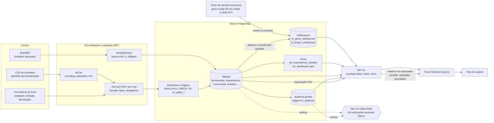

# Fluxo de integração de dados — das fontes até a tela

Este documento registra de onde vêm os dados do SOUFER Tools e o caminho que
cada um percorre até chegar à tela do usuário: o inventário legado da Soufer
(CSV), a BrasilAPI de feriados e o que a manutenção digita no balcão. As seções 1 e
2 descrevem as **fontes**; a seção 3 traz o **fluxo completo** (diagrama e
explicação de cada etapa, inclusive o calendário e as notificações que o
banco deriva dos empréstimos e das ocorrências); a seção 4 mostra como as **inconsistências** são
barradas, detectadas e rastreadas.

Atualizado em 24/10/2026: entrega de Transformação, Validação e Qualidade dos Dados
(20/10) e a API-17, que acrescentou o calendário e as notificações (seção 3.4).

- [1. Inventário legado da manutenção](#1-inventário-legado-da-manutenção)
- [2. BrasilAPI — feriados nacionais](#2-brasilapi--feriados-nacionais)
- [3. O fluxo completo: da fonte à tela](#3-o-fluxo-completo-da-fonte-à-tela)
- [4. Tratamento de inconsistências](#4-tratamento-de-inconsistências)

---

## 1. Inventário legado da manutenção

### Origem

**Atualização da visita técnica (01/09/2026):** a fonte é o **setor de
manutenção**, não o almoxarifado — o almoxarifado só guarda consumíveis, não
o ferramental que o sistema precisa controlar.

A manutenção enviou dois arquivos, no formato em que já os mantém
internamente (planilha/lista simples, sem padronização prévia — conforme
combinado, a normalização é responsabilidade da nossa equipe, não da
Soufer):

| Arquivo | Formato | Conteúdo |
|---|---|---|
| `dados_soufer/LISTA-DE-ITENS-DA-MANUTENÇÃO.docx` | Word, lista de parágrafos | Ferramentas e equipamentos de uso da manutenção (chaves, grifos, escadas, parafusadeira, paleteira, extensões elétricas, torquímetro etc.) |
| `dados_soufer/RELAÇAO-DE-MATERIAIS-NO-SETOR DE-MANUTENÇÃO.xlsx` | Excel, 2 colunas (`ITEM`, `QUANTIDADE`) | ~123 linhas, majoritariamente peças de reposição e material de consumo da manutenção (rolamentos, parafusos, correias, graxa, óleo) |

### Exemplo real de conteúdo

Trecho do `.docx` (ferramentas/equipamentos — candidatos diretos a virar
registros em `ferramentas`):

```text
Chave combinada gedore N ° 50,46,27,26 1un cada
Grifo irwin 24 polegadas 1un
Torquímetro gedore 80-360 NM, 60-260 tbt
Parafusadeira Bosch gsb 18v- 50- 1un
Paleteira TM capacidade.  2.500 kg - 1un
Extensão de fio 2 vias 8 mts - 1un
Chave Allen número 1.5 ,2.5, 3,4, 4.5, 5, 5.5, 6 ,8, 10 ,12  5un cada
Escada de alumínio 6mts  1un
```

Trecho do `.xlsx` (peça/material — provável **não** entrar em `ferramentas`
como está, ver observação abaixo):

```text
('LÂMPADA FLUORESCENTE 100W', 6)
('PARAFUSO ALLEN C/C  M 8 X 40', 10)
('ROLAMENTO 6205-ZZ', '4 pç')
('GRAXA LUBRAX LITH SM 2  (alta pressão)', '20 kg')
('OLEO LUBRIFICANTE HYDRA XP 32', '20 litros')
```

> **Observação para validar com a equipe:** o `.docx` lista itens no
> formato "ferramenta emprestável" (1 chave, 1 escada, 1 parafusadeira —
> compatível com `emprestimos`/`ferramentas.status`). Já o `.xlsx` é, na
> prática, estoque de peças de reposição e insumo de manutenção (parafusos,
> rolamentos, graxa, óleo) — não são itens que fazem sentido como um
> empréstimo individual rastreável. Recomendação: usar o `.docx` como base
> da primeira carga de `ferramentas`; decidir com o time se o `.xlsx` entra
> como catálogo de consumíveis (fora do escopo de empréstimo) ou fica de
> fora do MVP.

### Formato e qualidade dos dados de origem

- Sem código de identificação prévio — cada linha é só um nome descritivo
  livre + quantidade solta no texto (ex.: `"1un"`, `"5un cada"`, `"60 m"`,
  `"3un"`).
- Sem grupo/subgrupo, sem marca/modelo padronizados — tudo dentro do nome do
  item, exigindo normalização manual/heurística antes da carga.
- Alguns nomes têm caracteres corrompidos no arquivo original
  (`ç`/`ã`/`°` aparecem como `?`/mojibake em algumas linhas do `.xlsx`) —
  atenção ao reabrir o arquivo original com encoding UTF-8/Latin-1 correto
  antes de qualquer parser automatizado.
- Linhas em branco / células vazias existem no meio da planilha (ex.: linha
  com item `None`) — o parser de importação (`importacaoService`, DATA-03) descarta
  essas linhas.

### Uso previsto

Importação para a tabela `ferramentas` (fluxo completo descrito em
`dados.md`), com a estratégia de carga combinada na visita técnica:

- **Não importar tudo de uma vez.** Priorizar por valor/giro: primeiro
  máquinas e equipamentos maiores (ex.: parafusadeira, paleteira, escadas,
  extensões), depois chaves e itens de menor porte/maior volume.
- Cada linha do `.docx` vira um candidato a registro de `ferramentas`
  (`nome`, `grupo_id`/`subgrupo_id` atribuídos na normalização,
  `codigo_identificacao` gerado pelo trigger do banco — não vem do arquivo).
- O `.xlsx` fica pendente de decisão do time (ver observação acima) antes de
  entrar em qualquer carga.

---

## 2. BrasilAPI — feriados nacionais

### Origem

`GET https://brasilapi.com.br/api/feriados/v1/{ano}` — testada manualmente
em 03/09/2026 para o ano de 2026.

### Exemplo real de retorno

Resposta HTTP 200 completa salva em
[`backend/exemplos/brasilapi-feriados-2026.json`](../backend/exemplos/brasilapi-feriados-2026.json).
Trecho:

```json
[
  {
    "date": "2026-01-01",
    "name": "Confraternização mundial",
    "type": "national",
    "weekday": "quinta-feira"
  },
  {
    "date": "2026-04-21",
    "name": "Tiradentes",
    "type": "national",
    "weekday": "terça-feira"
  }
]
```

### Formato

Array de objetos com 4 campos, todos string:

| Campo | Exemplo | Mapeia para (`feriados`) |
|---|---|---|
| `date` | `"2026-01-01"` | `data` (`date`, único) |
| `name` | `"Confraternização mundial"` | `nome` |
| `type` | `"national"` | `tipo` |
| `weekday` | `"quinta-feira"` | — (não persistido; `ano` é extraído de `date`) |

### Uso previsto

- Cache local na tabela `feriados` (uma carga por ano).
- Cálculo de `previsao_devolucao` em dias úteis (pular fins de semana e
  datas presentes no cache).
- Classificação de empréstimo atrasado.
- Fallback se a API estiver fora: usar o cache local já existente; se o
  cache também estiver vazio, considerar apenas sábado/domingo como não
  úteis e registrar aviso em log (detalhado em `dados.md`).

---

## 3. O fluxo completo: da fonte à tela

### 3.1 Diagrama



### 3.2 Cada seta, em ordem

| De → Para | O que acontece | Onde está no código | Se falhar |
|---|---|---|---|
| CSV → `lerCsv` | Decodifica UTF-8 (cai para Windows-1252, que é como o Excel em português salva), detecta o separador (`;` ou `,`), tira o BOM, apara cada célula e descarta linhas vazias ou só com separadores | `api/src/utils/csv.ts` (`lerCsv`) | `400` "Não foi possível ler o arquivo CSV" ou "O arquivo CSV está vazio" |
| `lerCsv` → Zod | Normaliza o cabeçalho (minúsculas, sem acento, `grupo` vira `categoria`), confere colunas obrigatórias e repetidas, e o teto de 5000 linhas e 2 MB. Cada linha passa por `normalizarTexto` (espaços repetidos viram um) e pelo schema Zod: nome em maiúsculas, valor `1.234,56` ou `R$ 18,90` convertido em número, matrícula `36` completada para `0036` | `api/src/services/importacaoService.ts` (`importar`), `api/src/validators/importacaoValidator.ts` | Linha **rejeitada** com os motivos; as demais seguem (uma linha ruim não bloqueia as boas) |
| Formulário → Zod | Toda rota de escrita valida corpo, parâmetros e query com Zod antes de chegar ao serviço, e devolve o envelope de erro com `field`, `message` e `rule` | `api/src/validators/*`, middleware `validate` | `400 VALIDATION_ERROR` com `details`; JSON malformado dá `400 INVALID_JSON` |
| Zod → regras do banco | A linha válida vira `INSERT`. Referências por nome (categoria, setor) são resolvidas para id; duplicidade é conferida contra o banco e contra o próprio arquivo. Cada `INSERT` roda num `SAVEPOINT`, então um erro do banco numa linha não derruba as outras. As triggers e restrições valem de qualquer jeito (`uq_emprestimo_aberto`, `uq_ferramenta_codigo_ativo`, `chk_colaboradores_matricula_formato`, `fn_valida_retirada`, `fn_valida_subgrupo`) | `importacaoService` (`mensagemErroBanco`), migrations `0001` e `0004` | Na importação, a linha é rejeitada (`23505`, `23503`, `23514`). Nas rotas normais, o `errorHandler` traduz o erro do Postgres: `23505` → `409 DUPLICATE_ENTRY`, `23503` → `400 FOREIGN_KEY_VIOLATION`, `23514` (CHECK) → `400 CHECK_VIOLATION`, `P0001` (trigger) → `409 BUSINESS_RULE_VIOLATION`; a retirada ainda converte em `409 FERRAMENTA_INDISPONIVEL` |
| BrasilAPI → `feriadoService` | `GET https://brasilapi.com.br/api/feriados/v1/{ano}` com timeout de 5 s; o resultado é gravado por upsert (`ON CONFLICT (data)`) na tabela `feriados`, que serve de cache | `api/src/services/feriadoService.ts` (`sincronizarFeriados`), `npm run db:feriados` | BrasilAPI fora: `502 BRASIL_API_UNAVAILABLE` na sincronização; na leitura (`listarPorAno`) cai para o fallback de sábado e domingo. **Falha de banco não vira fallback** (erro de verdade, sem mascarar) |
| Restrições → tabelas | Dado que passou entra nas tabelas. Triggers de negócio atualizam o que depende dele: a retirada põe a ferramenta em `em_uso`; a devolução com avaria ou perda a move para `indisponivel` e abre a ocorrência herdando o colaborador | migration `0001` (`fn_sync_status_ferramenta`, `fn_abre_ocorrencia`) | A transação inteira desfaz (a API usa `BEGIN`/`COMMIT`) |
| Tabelas → `auditoria` | Cada `INSERT`, `UPDATE` e `DELETE` em `ferramentas`, `emprestimos` e `ocorrencias` grava uma linha em jsonb. O `UPDATE` guarda só as colunas que mudaram. O usuário vem do JWT, informado pela API no início da transação | migration `0014`, `definirUsuarioAuditoria` em `api/src/config/database.ts` | A trigger participa da transação: se a escrita desfaz, a auditoria também |
| Tabelas → views → API | As telas de listagem e o dashboard leem views (`vw_emprestimos_detalhe`, `vw_dashboard_kpis`) que juntam ferramenta, colaborador e setor e calculam a situação (`em_aberto`, `atrasado`, `devolvido`) | migrations `0001`, `0010`, `0013`; `emprestimoService`, `dashboardService`, `kpiService` | Erro de banco inesperado vira `500 INTERNAL_SERVER_ERROR` (em produção, sem detalhe) |
| API → front → tela | Resposta no envelope `{ data, meta }`; o front usa TanStack Query, invalida o cache depois de cada escrita e mostra a mensagem do `error.message` quando a API recusa | `web/src/lib/api.ts`, hooks em `web/src/` | A tela mostra o erro da API; falha de rede é distinguida de recusa |
| API → front (importação) | O relatório da importação (`resumo`, `aceitas`, `rejeitadas` com `motivos`, `ignoradas`) volta pronto e permite montar um CSV só com as linhas rejeitadas para corrigir e reenviar | `RelatorioImportacao` em `importacaoService.ts`; [`../backend/import/importacao-front.md`](../backend/import/importacao-front.md) | — |
| Tabelas → timer → `notificacoes` | O timer do servidor chama `fn_gerar_notificacoes()` ao subir e a cada 30 minutos. A função olha os empréstimos abertos e as ocorrências e grava um aviso por situação: `devolucao_hoje` (previsão é hoje), `atraso` (previsão já passou) e `ocorrencia_pendente` (ocorrência fora de `resolvida` e `baixada` aberta há mais de 7 dias; `PERDA` aparece como "extravio" no texto). Um aviso por empréstimo e por ocorrência, deduplicado pelo `link`. `fn_limpar_notificacoes()` roda ao subir e a cada 24 h e apaga as lidas com mais de 30 dias. O `pg_cron` só serve de reforço onde a extensão existe, e o Postgres do Dokploy não a traz | `api/src/server.ts`, migrations `0006`, `0007` e `0015` | Falha do timer vira `logger.warn` e o servidor segue de pé; a próxima rodada tenta de novo. O log registra quantos avisos foram gerados ou apagados, só quando maior que zero |
| `notificacoes` → API → sino | `GET /v1/notificacoes` lista os avisos da equipe (com `lida=false`, `meta.total` é o contador do sino); `PATCH` marca um ou todos como lidos. O estado `lida` é compartilhado entre os usuários da manutenção | `notificacaoService.ts`, [`../backend/api.md`](../backend/api.md#notificações-v1notificacoes) | `400` para filtro inválido, `404` se o aviso não existe |
| Tabelas → API → calendário | `GET /v1/emprestimos/calendario?mes=AAAA-MM` agrupa por dia as devoluções previstas dos empréstimos ainda abertos, com o dia calculado no fuso de Brasília | `emprestimoService`, [`../backend/api.md`](../backend/api.md#calendário-get-v1emprestimoscalendariomesaaaa-mm) | `400 VALIDATION_ERROR` se `mes` não for `AAAA-MM` |
| Tabelas → API → CSV | A exportação (`GET /v1/exportacoes/:recurso`) devolve o mesmo formato da importação (ponto e vírgula, BOM, `'` na frente de células que o Excel leria como fórmula) e a reimportação desfaz esse `'` | `exportacaoService.ts`, `utils/csv.ts` | `400` para filtro inválido |
| Tabelas e auditoria → `data:check` | Consultas somente de leitura procuram o que as regras acima deveriam ter impedido (status incoerente, datas trocadas, matrícula ou código repetidos, foto sem arquivo, trigger de auditoria desligada) | `api/src/services/dataCheckService.ts`, `api/scripts/data-check.ts` | Saída `1` se houver **erro**; avisos não reprovam |

> Observação sobre o front hoje: o `ImportarCsvDialog` ainda lê o arquivo no
> navegador e envia **uma requisição por linha** para `POST /v1/<recurso>`
> (cada linha passa pelo Zod da rota normal). O endpoint em lote
> `POST /v1/importacoes/:recurso` já está pronto, testado e documentado; a troca
> do front está descrita em [`../backend/import/importacao-front.md`](../backend/import/importacao-front.md).
> Os dois caminhos chegam às mesmas restrições do banco.

### 3.3 Exemplo ponta a ponta (importação do inventário)

Um CSV com 8 linhas de dados (arquivo e resposta reais em
[`entregas-pi/.../27-10-2026/evidencias/`](../entregas-pi/integracao-de-dados-max-vallim/27-10-2026/evidencias/)):

1. `lerCsv` lê as 8 linhas e o cabeçalho `nome;categoria;marca;modelo;setor;localizacao;descricao;valor`.
2. As linhas 2 e 3 viram `ZZEVID_FURADEIRA DE IMPACTO` (valor `1234.56`) e `ZZEVID_CHAVE DE FENDA PHILLIPS Nº 2` (valor `18.90`), com o código de identificação gerado pelo banco: **2 aceitas**.
3. As linhas 4, 5, 6 e 8 são recusadas pelo Zod ou pela resolução de categoria: categoria inexistente, valor com separador a mais, nome de uma letra e valor acima do teto de `NUMERIC(10,2)`: **4 rejeitadas**, cada uma com o motivo.
4. A linha 7 repete a linha 2 e a linha 9 já existe no banco (código 1): **2 ignoradas** (reenviar o mesmo arquivo é seguro).
5. A API responde `200` com o relatório. Cada linha aceita deixou uma linha de `INSERT` em `auditoria` com o usuário do token.
6. `GET /v1/ferramentas` e as demais telas passam a enxergar as ferramentas novas; `npm run data:check` continua sem erro.

### 3.4 Exemplo ponta a ponta (do atraso ao sino)

1. A manutenção registra a retirada de uma furadeira com previsão de devolução para 20/10. A linha entra em `emprestimos` e a ferramenta vai para `em_uso`.
2. Em 21/10 a previsão já passou. Na rodada seguinte do timer (no máximo 30 minutos depois), `fn_gerar_notificacoes()` grava um `atraso` com o texto "Furadeira com Maria Souza está atrasada desde 20/10" e o link `/ferramentas/12?emprestimo=41`. As rodadas seguintes não repetem o aviso.
3. `GET /v1/notificacoes?lida=false` devolve o aviso e `meta.total` alimenta o contador do sino.
4. A manutenção abre o aviso pelo link e marca como lido (`PATCH /v1/notificacoes/:id/lida`). Depois de 30 dias, `fn_limpar_notificacoes()` apaga a lida. Se o empréstimo continuar aberto, nasce um novo aviso: na prática, um lembrete mensal.
5. A devolução com avaria ou perda abre a ocorrência (Regra 3). Se ela ficar mais de 7 dias sem solução, o timer gera um `ocorrencia_pendente` ("... com ocorrência de extravio sem solução há 8 dias").

Evidência de execução: [`../testes/api-17-notificacoes/`](../testes/api-17-notificacoes/).

## 4. Tratamento de inconsistências

A estratégia tem quatro camadas, da mais barata (impedir) à mais tardia (corrigir):

1. **Prevenir:** validação Zod na API e restrições no banco, que valem para qualquer caminho de escrita.
2. **Detectar:** `npm run data:check`, que aponta o que escapou (dado antigo, escrita direta no banco, bug).
3. **Rastrear:** `auditoria` em jsonb, para saber quem mudou o quê e o valor anterior.
4. **Corrigir:** o relatório de importação lista cada linha recusada com o motivo, para quem cuida da planilha na manutenção ajustar a planilha e reenviar; para dado já gravado, o `data:check` diz como corrigir.

| Problema | Onde é barrado | Resposta ao usuário | Como é detectado depois |
|---|---|---|---|
| Ferramenta já emprestada | Índice `uq_emprestimo_aberto` e trigger `fn_valida_retirada` | `409 FERRAMENTA_INDISPONIVEL` | `EM_USO_SEM_EMPRESTIMO`, `EMPRESTIMO_ABERTO_FERRAMENTA_NAO_EM_USO` |
| Campo obrigatório ausente ou formato errado (nome, matrícula, previsão) | Zod nas rotas | `400 VALIDATION_ERROR` com `field` e `message` | — (nem chega ao banco) |
| Previsão de devolução no passado | Zod (`previsaoDevolucao não pode estar no passado`) | `400 VALIDATION_ERROR` | `EMPRESTIMO_PREVISAO_ANTES_RETIRADA` (dado legado ou escrita direta) |
| Devolução inválida (condição inexistente, custo em devolução ok) | Zod | `400 VALIDATION_ERROR` | `EMPRESTIMO_DEVOLVIDO_SEM_CONDICAO` |
| Matrícula repetida ou fora do formato | Zod (4 dígitos), `UNIQUE` e `CHECK` no banco | `400 VALIDATION_ERROR`; se escapar da API, `409 DUPLICATE_ENTRY` ou `400 CHECK_VIOLATION` | `COLABORADOR_MATRICULA_DUPLICADA` (conferência defensiva, também sem diferenciar maiúsculas e espaços) |
| Subgrupo de outro grupo | Trigger `fn_valida_subgrupo` | `409 BUSINESS_RULE_VIOLATION` com a mensagem da trigger | `FERRAMENTA_SUBGRUPO_FORA_DO_GRUPO` (cobre o caso de o subgrupo mudar de grupo depois) |
| Avaria ou perda sem ocorrência | Trigger `fn_abre_ocorrencia` abre sozinha | Resposta da devolução traz o id da ocorrência | `INDISPONIVEL_SEM_OCORRENCIA_ABERTA`, `INDISPONIVEL_SEM_MOTIVO` |
| Linha ruim num CSV | Zod por linha, resolução de categoria/setor, teto de 5000 linhas | `200` com o relatório (`rejeitadas` com motivos, `ignoradas`) | — |
| JSON malformado | Parser do Express | `400 INVALID_JSON` | — |
| BrasilAPI fora do ar | `feriadoService` | Fallback de sábado e domingo (Regra 9); `502` só na sincronização forçada | — |
| Banco fora do ar | Pool `pg` (`connectionTimeoutMillis` de 5 s) | `500` (em produção, sem detalhe); o processo continua de pé, porque erro em conexão emprestada é capturado | `npm run data:check` sai com `2` |
| Aviso repetido a cada rodada do timer | `fn_gerar_notificacoes()` confere o `link` e a data antes de inserir (idempotente) | A segunda execução gera 0 | — |
| Servidor sem `pg_cron` (Dokploy) | Timer do `server.ts` faz o papel do agendador | Nenhuma; a falha do timer só aparece como aviso no log | Sem avisos novos no sino e `logger.warn` no log |
| Alguém desligou a auditoria | — | — | `AUDITORIA_TRIGGER_AUSENTE`, `AUDITORIA_SEM_REGISTRO` |

## Referências relacionadas

- [`dados.md`](dados.md) — pipeline de importação/normalização e regras de
  qualidade de dados.
- [`dicionario-de-dados.md`](dicionario-de-dados.md) — schema completo (15 tabelas
  das migrations `0001` a `0015`), incluindo `ferramentas`, `feriados` e `auditoria`.
- [`../regras-negocio.md`](../regras-negocio.md) — as 10 regras, onde vivem e o mapa regra → teste.
- [`../backend/importacao.md`](../backend/importacao.md) e [`../backend/processos.md`](../backend/processos.md)
  — importação passo a passo, auditoria e `data:check`.
- `CLAUDE.md`, Seção 3 — regras de negócio inegociáveis.
