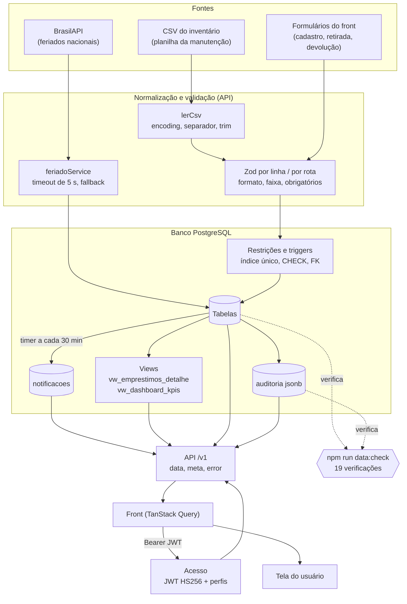
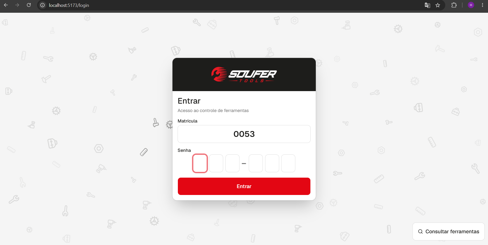
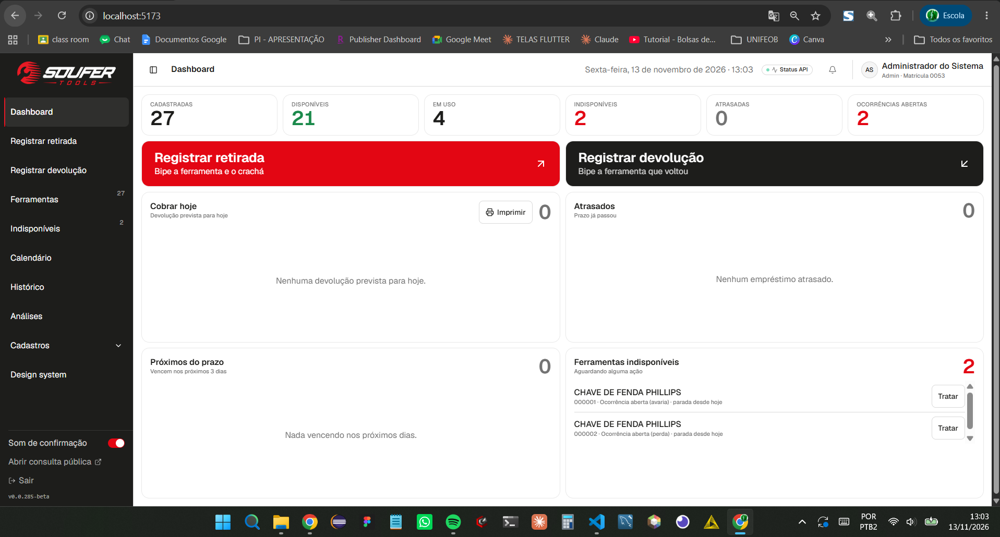
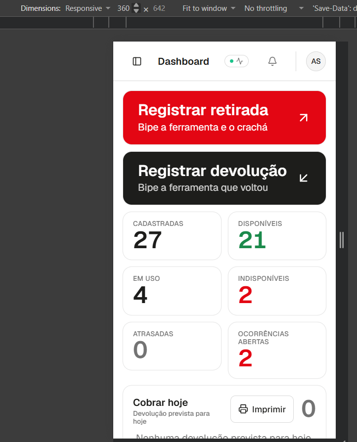
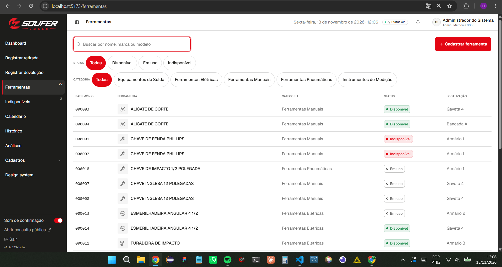
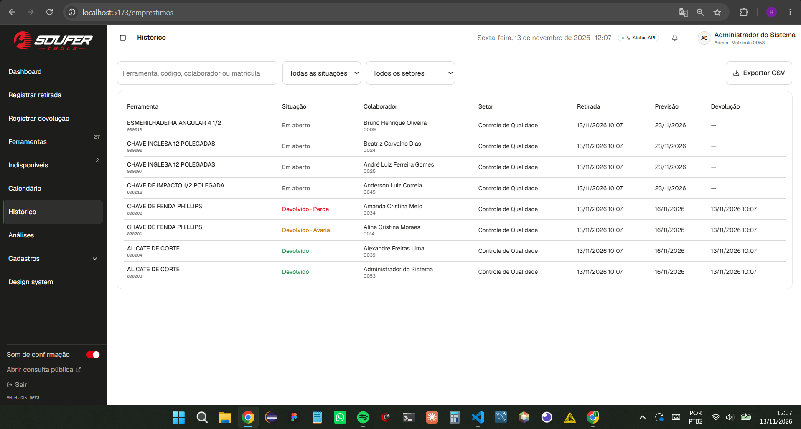
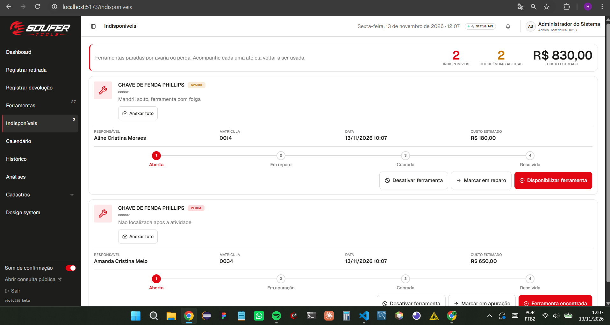
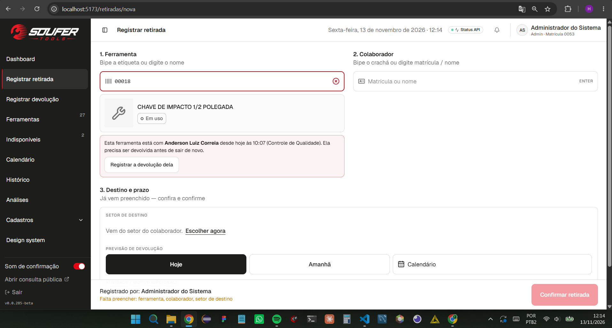
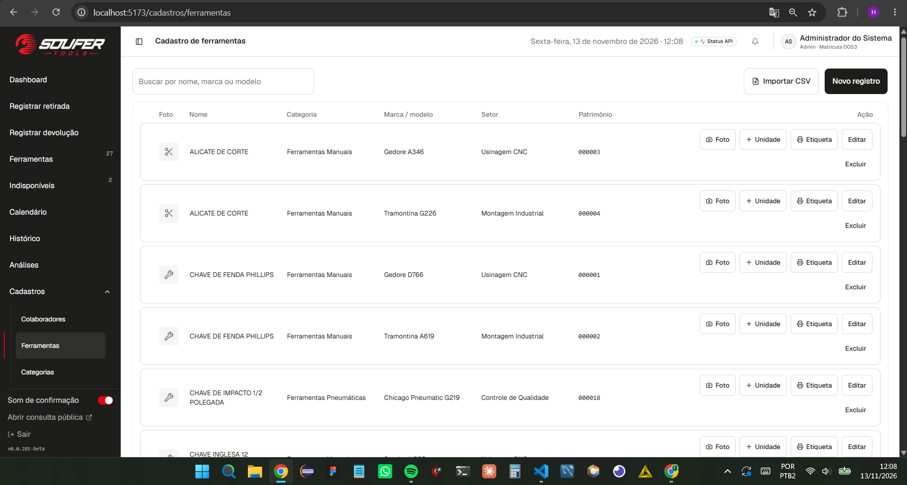
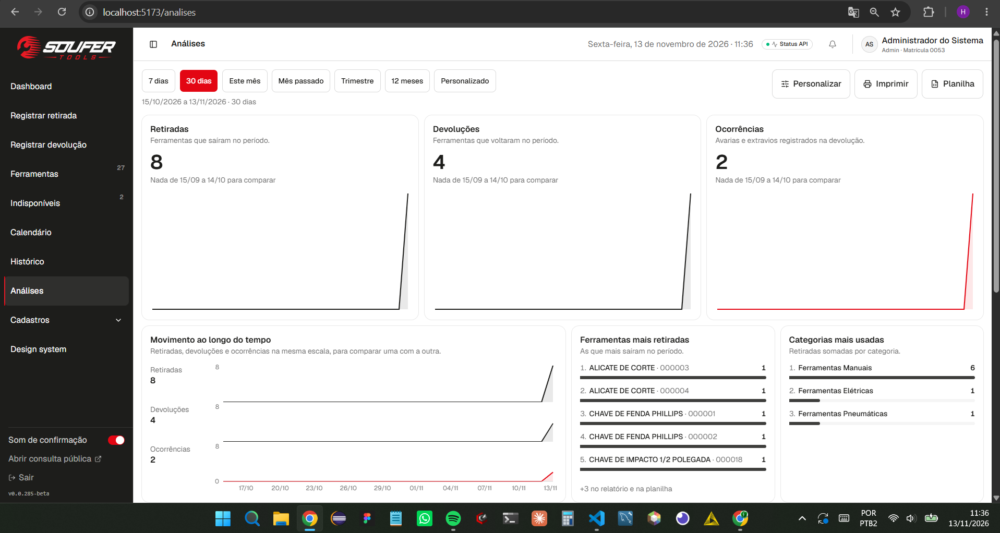

# 1. Contexto

Esta entrega atende à atividade do projeto de extensão do dia 10/11/2026, do Prof. Max Vallim:
**Camada Final de Integração e Disponibilização dos Dados**. O enunciado pede que a camada de
integração de dados da aplicação esteja consolidada, com as informações prontas para consumo pela
API e pelas interfaces das demais unidades de estudo, e que se demonstre o fluxo completo dos
dados, da origem até o consumo pela aplicação, com a documentação da arquitetura de integração,
evidências de funcionamento e os controles de qualidade implementados. Prazo de entrega: 17/11/2026.

O projeto é o **SOUFER Tools**, sistema web de controle de retirada e devolução de ferramentas do
setor de manutenção da Soufer (beneficiada do projeto de extensão; ODS 9 e, em segundo plano, 12).
O valor do sistema está no dado: se o status de uma ferramenta não bate com a realidade, ou se dois
empréstimos abertos disputam o mesmo item, o controle perde o sentido.

Esta entrega **fecha o ciclo** das duas anteriores do Prof. Max. Em 05/09 foi entregue o banco e a
integração inicial com a fonte externa; em 20/10, o tratamento, a validação e a qualidade dos dados
(`data:check`, auditoria, importação de CSV). Agora o foco é a **ponta de consumo**: o dado que
entrou, foi validado e foi guardado precisa chegar, correto e protegido, a quem o usa.

## 1.1 Como o enunciado foi atendido

| O que o enunciado pede | O que foi entregue | Onde está |
|---|---|---|
| Camada de integração consolidada | Três fontes (CSV do inventário, BrasilAPI de feriados, formulários do balcão) passando por normalização, validação e restrições do banco | Seção 2.1 |
| Dados prontos para consumo pela API e pelas interfaces | API `/v1` com 18 grupos de rotas, envelope único de resposta e de erro, views de leitura, dashboard e 11 KPIs de gestão | Seção 2.2 |
| Fluxo completo, da origem ao consumo | Diagrama, tabela etapa por etapa e uma execução real e reproduzível da carga ao dashboard | Seções 3 e 4 |
| Documentação da arquitetura de integração | `fluxo-integracao.md`, dicionário de dados com as views, `arquitetura.md`, regras de negócio e DER | Seção 5 |
| Evidências de funcionamento | Sete arquivos gerados por execução real em 13/11/2026 contra a API e o banco, mais nove prints da interface com os mesmos dados | Seção 4 |
| Controles de qualidade | Validação em três camadas, `data:check` (19 verificações), auditoria em jsonb, 777 testes, proteção de acesso por JWT e perfis | Seção 2.3 |

# 2. O que foi feito

## 2.1 Fontes e integração

| Fonte | Natureza | Como entra | Onde fica |
|---|---|---|---|
| Inventário da manutenção | CSV/planilha sem padronização (nomes em caixa mista, valor em formato brasileiro) | `POST /v1/importacoes/ferramentas`, em ondas de até 5000 linhas | `ferramentas` |
| BrasilAPI (feriados nacionais) | API externa, JSON | `npm run db:feriados` e leitura sob demanda, com cache | `feriados` |
| Balcão da manutenção | Formulários (cadastro, retirada, devolução) | Rotas de escrita `/v1/*` | `ferramentas`, `emprestimos`, `ocorrencias`, `colaboradores` |

A importação de CSV percorre sete etapas (leitura com detecção de encoding e separador, cabeçalho,
normalização por linha, validação Zod, deduplicação, carga transacional com um `SAVEPOINT` por linha
e relatório). **Uma linha ruim nunca bloqueia as boas**, e reenviar o mesmo arquivo é seguro. A
integração com a BrasilAPI grava os feriados por *upsert* numa tabela que serve de cache; se a API
externa falhar, o sistema cai para o fallback de sábado e domingo (regra 9) em vez de parar. O
detalhamento de cada etapa está em `docs/backend/importacao.md` e em
`docs/banco-de-dados/fluxo-integracao.md`.

## 2.2 Disponibilização dos dados para a API e a interface

O dado só tem valor se chegar a quem o usa. A camada de disponibilização é a API REST em
`/v1`, documentada no Swagger (`/docs`), com um contrato único:

- **Resposta de sucesso:** `{ "data": ..., "meta": { "page", "limit", "total" } }`.
- **Resposta de erro:** `{ "error": { "code", "message", "details" } }`, com o mesmo formato em
  todas as rotas. O tratador global traduz os erros do PostgreSQL em códigos de negócio (`23505`
  vira `409 DUPLICATE_ENTRY`, `23514` vira `400 CHECK_VIOLATION`, `P0001` vira `409
  BUSINESS_RULE_VIOLATION`) sem vazar valores da linha.
- **Versionamento:** prefixo `/v1`; quebra de contrato vai para `/v2`.

| Grupo de rotas | O que disponibiliza | Quem acessa |
|---|---|---|
| `/ferramentas`, `/colaboradores`, `/setores`, `/categorias`, `/atividades`, `/opcoes` | Cadastros e listas para os formulários | Manutenção e admin (edição e inativação só do admin) |
| `/emprestimos` | Retirada, devolução, listagem com situação, calendário de vencimentos e previsão sugerida em dias úteis | Manutenção e admin |
| `/ocorrencias` | Ocorrências abertas pela devolução com avaria ou perda, com acompanhamento de etapas | Manutenção e admin |
| `/dashboard` | Seis contadores, quatro cartões de ação, atrasos por setor e listas paginadas | Manutenção e admin |
| `/kpis/*` | 11 indicadores de gestão por período (`de`/`ate`) | Manutenção e admin (colaboradores que mais retiram: só admin) |
| `/notificacoes` | Avisos gerados no banco (devolução hoje, atraso, ocorrência pendente) | Manutenção e admin |
| `/feriados` | Feriados, verificação de dia útil e cálculo de dias úteis | Aberta à leitura |
| `/importacoes` e `/exportacoes` | Carga e extração de CSV no mesmo formato | Manutenção e admin (setores e categorias: só admin) |
| `/auditoria` | Trilha de quem alterou o quê | Só admin |
| `/consulta` | Disponibilidade de ferramentas, sem dado de pessoas | Perfil `consulta` (quiosque, sessão de 15 minutos) |

O banco ainda oferece **três views** que a API e o front consomem: `vw_emprestimos_detalhe`
(empréstimo com ferramenta, colaborador, setor e responsáveis), `vw_dashboard_kpis` (os contadores) e
`vw_ocorrencias_por_colaborador`, esta última sem rota que a consuma hoje. Elas estão descritas campo
a campo no dicionário de dados. Duas regras de consistência valem a pena citar:

- **Coerência dentro de uma resposta.** O dashboard lê todos os números numa única transação
  `REPEATABLE READ` somente leitura. Mesmo com devoluções acontecendo ao lado, os contadores e os
  cartões da mesma resposta batem entre si.
- **Uma só definição de "atrasado".** Atrasado é a previsão em dia anterior ao de hoje, no fuso de
  Brasília. Essa definição vale para o contador, o cartão e o gráfico por setor, e é mantida num
  único ponto do código (`CONDICAO_ATRASADOS`). A view `vw_dashboard_kpis` usa uma comparação por
  instante, e por isso a API recalcula esse contador.

## 2.3 Controles de qualidade

A estratégia tem quatro camadas, da mais barata (impedir) à mais tardia (corrigir):

1. **Prevenir.** Validação em três camadas: formulário no front, **Zod** em todas as rotas de
   escrita, e o **banco** (índice único parcial, `CHECK`, chave estrangeira e triggers), que vale até
   para quem escreve fora da API.
2. **Detectar.** `npm run data:check` roda 19 consultas somente de leitura que procuram o que as
   regras deveriam ter impedido (status incoerente, datas trocadas, matrícula ou código repetidos,
   foto sem arquivo, trigger de auditoria desligada). Sai com `0` sem erro, `1` com erro e `2` se
   não conseguiu rodar.
3. **Rastrear.** Triggers gravam em `auditoria` (jsonb) cada `INSERT`, `UPDATE` e `DELETE` em
   `ferramentas`, `emprestimos` e `ocorrencias`. O `UPDATE` guarda só as colunas que mudaram, e o
   usuário vem do JWT, nunca do corpo da requisição (regra 6).
4. **Corrigir.** O relatório da importação diz, linha a linha, o motivo da recusa, e o `data:check`
   diz como corrigir cada achado.

A esses controles somou-se a **proteção do acesso aos dados**, que a camada de disponibilização exige:

| Controle | Como funciona |
|---|---|
| Algoritmo fixo | Tokens assinados e verificados num único ponto (`tokenJwt.ts`), com `HS256`. `alg: none` e qualquer outro algoritmo dão `401 TOKEN_INVALID` |
| Dois tipos de token, separados | Sessão de balcão (7 dias, `aud: soufer-sessao`) e quiosque (15 minutos, `aud: soufer-consulta`). O `aud` precisa bater com o perfil, então um tipo nunca vale no lugar do outro |
| Três perfis | `manutencao`, `admin` e `consulta`, conferidos por rota (`403 ACCESS_DENIED`). A consulta vê só nome, categoria, status e localização |
| Varredura de rotas | Um teste percorre **todas** as rotas `/v1`, exigindo autenticação, `403` ao token de consulta e `401` ao token vencido |
| Segredos por ambiente | Fora de `development` e `test`, a API se recusa a subir com o `JWT_SECRET` ou a senha do banco de exemplo; o `db:seed` segue a mesma regra |
| Limite de tentativas | Login e consulta têm limite por IP e por matrícula |

# 3. Fluxo de integração dos dados



| De → Para | O que acontece | Se falhar |
|---|---|---|
| CSV → `lerCsv` → Zod | Decodifica, normaliza cabeçalho e texto, converte valor, valida cada linha | Linha rejeitada com o motivo; as demais seguem |
| Formulário → Zod | Valida corpo, parâmetros e *query* da rota | `400 VALIDATION_ERROR` com `details` |
| Zod → regras do banco | `INSERT` com restrições e triggers; cada linha num `SAVEPOINT` | Linha rejeitada ou `409`/`400` com código de negócio |
| BrasilAPI → `feriadoService` | Timeout de 5 s, *upsert* em `feriados` | Fallback de sábado e domingo; erro de banco não vira fallback |
| Restrições → tabelas | Triggers atualizam o que depende (status da ferramenta, ocorrência) | A transação inteira desfaz |
| Tabelas → `auditoria` | Uma linha por alteração real, com o diff e o usuário do JWT | Desfaz junto com a escrita |
| Tabelas → `notificacoes` | O timer do servidor gera os avisos de devolução, atraso e ocorrência pendente | O servidor segue de pé; a próxima rodada tenta de novo |
| Tabelas → views → API | Listagens e dashboard leem views | `500` (em produção, sem detalhe) |
| Front → acesso → API | O token é conferido (algoritmo, `aud`, validade) e o perfil, por rota | `401` ou `403` |
| API → front → tela | Envelope `{ data, meta }`; o front invalida o cache após cada escrita e mostra o erro da API | Falha de rede distinguida de recusa |
| Tabelas e auditoria → `data:check` | Consultas de leitura procuram o que as regras deveriam ter impedido | Saída `1` se houver erro |

O documento completo, com o caminho de cada seta no código, está em
`docs/banco-de-dados/fluxo-integracao.md`.

# 4. Evidências de funcionamento

Todas as evidências abaixo foram geradas em **13/11/2026**, por execução real contra o banco de
desenvolvimento (`soufer_dev`, PostgreSQL local) e a API rodando localmente. Os arquivos completos
estão em `10-11-2026/evidencias/`. Antes da execução, os dados operacionais antigos do ambiente
(resíduo de testes e de coleções do Insomnia) foram removidos e o banco foi repopulado com dados
fictícios, para que a demonstração parta de um estado conhecido. Foram removidas as ferramentas,
os empréstimos, as ocorrências e as notificações, mais os setores, categorias e colaboradores
criados só por testes de CRUD. Cada limpeza ocorreu numa transação, com as contagens conferidas
antes do `COMMIT`; os `DELETE` de ferramentas, empréstimos e ocorrências ficaram registrados na
`auditoria`.

| Arquivo | O que prova |
|---|---|
| `01-migrations.txt` | Banco atualizado, sem migration pendente |
| `02-data-check.txt` | As 19 verificações de consistência |
| `03-testes-vitest.txt` | Saída completa da suíte de testes |
| `04-feriados-brasilapi.txt` | Integração com a fonte externa |
| `05-importacao-relatorio.json` | Resposta real da importação de CSV |
| `06-movimento-via-api.txt` | Retiradas, devoluções e a abertura automática de ocorrências |
| `07-consumo-api-dashboard.txt` | Os dados chegando ao consumidor pela API |
| `importacao-carga-fake.csv` | O arquivo usado na importação |
| `prints/` (9 imagens) | Os mesmos dados vistos na interface (seção 4.7) |

## 4.1 Preparação e fonte externa

`npm run db:migrate` respondeu "Nenhuma migration pendente", com as 15 migrations aplicadas. A
sincronização dos feriados gravou os dados da BrasilAPI:

```text
⏳ Sincronizando ano 2026...
✅ Ano 2026: 14 feriados inseridos/atualizados com sucesso!
🎉 Processo finalizado! Total de 14 registros sincronizados na tabela 'feriados'.
```

Na primeira tentativa do dia a chamada estourou o timeout de 5 s (a BrasilAPI respondeu em 5,3 s) e o
comando informou o erro sem gravar nada, como previsto pela regra 9. As tentativas seguintes
funcionaram. O fallback e o cache têm testes próprios (`feriadoFallback.test.ts`).

## 4.2 Carga: importação do inventário

O admin enviou `importacao-carga-fake.csv` (34 linhas de dados, com quatro defeitos de propósito) a
`POST /v1/importacoes/ferramentas`. Resposta `200`:

```json
{ "resumo": { "total_linhas": 34, "aceitas": 27, "rejeitadas": 6, "ignoradas": 1 } }
```

| Linha | Motivo |
|---|---|
| 18, 25 e 29 | Rejeitadas: `Setor "Usinagem e Ajustagem" não cadastrado` |
| 32 | Rejeitada: `Categoria "Categoria Inexistente" não cadastrada` |
| 33 | Rejeitada: `Valor inválido (use o formato 1.234,56)` |
| 34 | Rejeitada: `Nome deve ter no mínimo 2 caracteres` |
| 35 | Ignorada: `Repetida no arquivo (mesma da linha 2)` |

As rejeições das linhas 18, 25 e 29 **não foram planejadas**: o setor "Usinagem e Ajustagem" está
inativo no cadastro, e a API o recusa. É a regra de integridade funcionando sobre dado real, e por
isso o resultado foi mantido. As 27 linhas aceitas viraram ferramentas com o código de
identificação gerado pelo banco.

## 4.3 Movimento: retiradas, devolução e ocorrências automáticas

Com o login da manutenção (`0001`), foram feitas 8 retiradas e 4 devoluções pela API:

```text
POST /emprestimos ferramenta=49573 (ALICATE DE CORTE)            -> HTTP 201
POST /emprestimos ferramenta=49574 (ALICATE DE CORTE)            -> HTTP 201
POST /emprestimos ferramenta=49571 (CHAVE DE FENDA PHILLIPS)     -> HTTP 201
POST /emprestimos ferramenta=49572 (CHAVE DE FENDA PHILLIPS)     -> HTTP 201
... (mais 4 retiradas, todas HTTP 201)
Retirar de novo a mesma ferramenta -> HTTP 409 FERRAMENTA_INDISPONIVEL
PATCH devolucao emprestimo=7161 ok     -> HTTP 200
PATCH devolucao emprestimo=7162 ok     -> HTTP 200
PATCH devolucao emprestimo=7163 avaria -> HTTP 200 ocorrencia=5529
PATCH devolucao emprestimo=7164 perda  -> HTTP 200 ocorrencia=5530
```

Três regras de negócio aparecem aqui, executadas de verdade. A regra 1 (um empréstimo aberto por
ferramenta) devolve `409` na segunda retirada. A regra 3 (avaria ou perda abre ocorrência
automaticamente, herdando o colaborador, e move a ferramenta para `indisponivel`) gerou as
ocorrências 5529 e 5530 **sem nenhuma chamada extra**: foi a trigger do banco. A regra 6
(responsável vem do JWT) é respeitada em todas as chamadas, porque nenhuma delas envia o usuário no
corpo.

## 4.4 Consumo: o dado chegando à interface

Com o token do admin, as rotas que alimentam o dashboard responderam:

```text
GET /v1/dashboard/kpis
{"data":{"cadastradas":27,"disponiveis":21,"em_uso":4,"indisponiveis":2,"atrasadas":0,"ocorrencias":2}}

GET /v1/dashboard/atrasos
{"data":[]}
```

**A conta fecha:** 27 cadastradas = 21 disponíveis + 4 em uso + 2 indisponíveis. É exatamente o
que o movimento da seção 4.3 produziu: 8 retiradas, 4 devolvidas (2 viram `disponivel` de novo, 1
`avaria` e 1 `perda` viram `indisponivel`) e 4 ainda em uso; as 2 ocorrências abertas aparecem em
`ocorrencias`. Não há atrasos, porque a validação impede previsão de devolução no passado. A rota
`GET /v1/ferramentas?status=indisponivel` também devolve as duas ferramentas, com
`motivo_indisponivel` `avaria` e `perda`.

## 4.5 `data:check` sobre o estado final

```text
🔎 SOUFER Tools — verificação de consistência dos dados
Banco: soufer_dev @ 127.0.0.1:5432

✅ EM_USO_SEM_EMPRESTIMO......................... 0
✅ EMPRESTIMO_ABERTO_FERRAMENTA_NAO_EM_USO....... 0
✅ INDISPONIVEL_SEM_MOTIVO....................... 0
✅ INDISPONIVEL_SEM_OCORRENCIA_ABERTA............ 0
✅ AUDITORIA_TRIGGER_AUSENTE..................... 0
✅ AUDITORIA_SEM_REGISTRO........................ 0
... (as 19 linhas estão em 02-data-check.txt)

Resumo: 19 verificações · 19 ok · 0 com erro · 0 com aviso
Resultado: tudo certo (saída 0)
```

Na primeira execução do dia, **antes** da limpeza, o mesmo comando acusou 2 avisos: 20 ferramentas
indisponíveis sem ocorrência aberta (resíduo das coleções do Insomnia) e 4 fotos cujo arquivo não
existia no disco. O comando os encontrou e disse como corrigir. Depois da limpeza e da repopulação,
o resultado é 19 de 19. Rodado de novo **depois da suíte de testes**, o resultado se manteve, o que
mostra que os testes não deixam resíduo no banco. Cada verificação é testada forçando a
inconsistência dentro de uma transação revertida (`dataCheck.test.ts`).

## 4.6 Testes automatizados

`npm test` (Vitest + Supertest, contra o banco de desenvolvimento): **47 arquivos, 777 testes, todos
passando**. Na entrega de 20/10 eram 42 arquivos e 437 testes. O resultado se repetiu em duas
execuções no dia, uma antes e outra depois da repopulação do banco. O crescimento vem principalmente
destes arquivos:

| Arquivo | O que cobre |
|---|---|
| `dashboard.test.ts` | Os seis contadores, conferidos contra contagem direta na mesma transação `REPEATABLE READ` |
| `kpi.test.ts` | Os 11 KPIs de gestão, filtros por período e permissões |
| `segurancaRotas.test.ts` | Varredura de todas as rotas `/v1`: exige token, `403` à consulta, `401` ao token vencido |
| `invasaoSimuladaJwt.test.ts` e `jwtHardening.test.ts` | `alg: none`, outro algoritmo, `aud` trocado e token sem `aud` |
| `jwtExpiracao.test.ts` | Validade de 7 dias (sessão) e 15 minutos (consulta), lida do `exp` emitido |
| `envSegredos.test.ts` | Recusa de segredo e senha de exemplo fora de desenvolvimento |
| `gerarNotificacoes.test.ts` e `limpezaNotificacoes.test.ts` | Avisos gerados e limpos pelo banco |
| `dataCheck.test.ts`, `auditoria.test.ts`, `feriadoFallback.test.ts` | Controles da entrega anterior, mantidos |

## 4.7 Evidências de tela: o dado na interface

Os prints abaixo foram tirados em 13/11/2026, com o front (Vite, `localhost:5173`) apontando para a
API local e o banco da seção 4. Mostram, em tela, o mesmo dado que as seções 4.2 a 4.4 provam por
API. Os nomes de colaboradores que aparecem vêm da massa de teste do ambiente (criada pelo seed da
API-09 para o teste de desempenho da busca); não são dados de funcionários.

| # | Tela | O que prova |
|---|---|---|
| 1 | Login | Entrada pelo perfil, com matrícula e PIN de 6 dígitos |
| 2 e 3 | Dashboard em 1280 px e em 360 px | Os seis contadores (**27, 21, 4, 2, 0, 2**) iguais aos de `GET /v1/dashboard/kpis`, os quatro cartões e a lista de indisponíveis |
| 4 | Ferramentas | As 27 ferramentas importadas do CSV, com status (disponível, em uso, indisponível) e o patrimônio gerado pelo banco |
| 5 | Histórico de empréstimos | As 8 retiradas da seção 4.3: 4 em aberto, 2 devolvidas normalmente, 1 devolvida com avaria e 1 com perda |
| 6 | Indisponíveis | As duas ocorrências abertas **sozinhas** pela devolução (regra 3), com responsável herdado do empréstimo e custo estimado somando R$ 830,00 (180 + 650) |
| 7 | Retirada de ferramenta em uso | A regra 1 na tela: a interface avisa com quem a ferramenta está, informa que ela precisa ser devolvida antes de sair de novo e oferece o atalho para registrar a devolução |
| 8 | Cadastro de ferramentas (admin) | A porta de entrada do CSV ("Importar CSV") disponível só ao perfil admin |
| 9 | Análises | Os KPIs de gestão no período de 30 dias: 8 retiradas, 4 devoluções, 2 ocorrências e o ranking de ferramentas e categorias |


*Figura 1. Tela de login (matrícula 0053, perfil admin).*


*Figura 2. Dashboard em 1280 px: 27 cadastradas, 21 disponíveis, 4 em uso, 2 indisponíveis, 0 atrasadas, 2 ocorrências abertas.*


*Figura 3. O mesmo dashboard em 360 px (largura mínima do projeto).*


*Figura 4. Lista de ferramentas vinda da importação do CSV (selo 27 no menu).*


*Figura 5. Histórico: retiradas em aberto, devolução com perda, com avaria e devoluções normais.*


*Figura 6. Ferramentas indisponíveis com a ocorrência aberta automaticamente pela devolução.*


*Figura 7. Retirada de uma ferramenta que já está em uso: a interface informa com quem ela está.*


*Figura 8. Cadastro de ferramentas do perfil admin, com o botão de importação de CSV.*


*Figura 9. Análises dos últimos 30 dias, alimentadas pelos KPIs de gestão da API.*

Na figura 7 o aviso aparece porque a tela consulta a ferramenta antes de confirmar. A recusa pelo
**banco** (`409 FERRAMENTA_INDISPONIVEL`, mesmo se alguém ignorar a tela) está na seção 4.3.

# 5. Documentação produzida e atualizada

| Documento | O que mudou nesta entrega |
|---|---|
| `docs/banco-de-dados/fluxo-integracao.md` | Consumo pelo dashboard e pelos KPIs, camada de acesso (JWT e perfis), cinco linhas novas de tratamento de inconsistências e uma execução real da carga ao dashboard (seção 3.5) |
| `docs/banco-de-dados/dicionario-de-dados.md` | Migrations até a `0015`, conferência das 15 tabelas contra o banco real e nova seção com as três views |
| `docs/backend/arquitetura.md` | Segurança dos tokens, KPIs de gestão e notificação de ocorrência pendente |
| `docs/regras-negocio.md` | As 10 regras, o calendário e as notificações, com o mapa regra → teste |
| `docs/banco-de-dados/der.dbml` e PNG do DER | DER regerado a partir do `.dbml` |
| `10-11-2026/evidencias/` | Sete arquivos de evidência, o CSV usado e nove prints da interface |

# 6. Como reproduzir

Na raiz do repositório, com o PostgreSQL de desenvolvimento acessível e `NODE_ENV=development`:

```bash
npm --prefix api run db:migrate          # aplica as migrations pendentes
npm --prefix api run db:seed             # base: setores, grupos, atividades, colaboradores e usuários
npm --prefix api run db:feriados -- 2026 # 14 feriados da BrasilAPI
npm --prefix api run dev                 # sobe a API em http://localhost:3000 (Swagger em /docs)
```

Com a API no ar, o admin (matrícula `0053`) obtém o token em `POST /v1/auth/login` e envia o CSV:

```bash
curl -X POST http://localhost:3000/v1/importacoes/ferramentas \
  -H "Authorization: Bearer $TOKEN" -H "Content-Type: text/csv" \
  --data-binary @docs/entregas-pi/integracao-de-dados-max-vallim/10-11-2026/evidencias/importacao-carga-fake.csv
```

Depois, retiradas e devoluções por `POST /v1/emprestimos` e `PATCH /v1/emprestimos/:id/devolucao`, e
a conferência dos números:

```bash
curl http://localhost:3000/v1/dashboard/kpis -H "Authorization: Bearer $TOKEN"
npm --prefix api run data:check          # sai com 0 se não houver erro
npm --prefix api test                    # 47 arquivos, 777 testes
```

O `db:seed` cria contas com a senha `123456` e só roda com `NODE_ENV=development` ou `test`. O
primeiro admin de produção sai de `npm run db:admin`, com link de convite e sem senha padrão.

# 7. Limitações e próximos passos

Esta seção lista o que não está pronto, sem esconder nenhum ponto.

- **Evidência só em ambiente de desenvolvimento.** A execução e os prints desta entrega foram feitos
  no banco e no front locais. A aplicação também roda em produção (Dokploy), com prints de banco, backup e saúde da API
  em `docs/prints/`, mas a execução da carga e do `data:check` **não foi repetida em produção**.
- **Importação pelo front ainda é linha a linha.** O `ImportarCsvDialog` lê o arquivo no navegador
  e envia uma requisição por linha às rotas normais. O endpoint em lote `POST /v1/importacoes/:recurso`
  está pronto, testado e documentado (`docs/backend/import/importacao-front.md`), mas o front ainda
  não o usa.
- **`data:check` fora do CI.** O comando já devolve código de saída adequado e `--json`, mas não roda
  no pipeline do repositório.
- **Auditoria sem tela e sem política de retenção.** Existe `GET /v1/auditoria` (só admin), mas não
  há tela, e a tabela cresce com o uso.
- **`vw_ocorrencias_por_colaborador` sem uso.** A view existe e está documentada, mas nenhuma rota
  nem tela a consome.
- **Regra 7 em revisão.** O código de identificação de 4 dígitos funciona e é testado, mas a decisão
  entre etiqueta e gravação a lápis elétrico ainda depende de ata.
- **Tempo limite da BrasilAPI.** O timeout de 5 s foi curto numa das tentativas do dia. O
  comportamento está correto (informa o erro, não grava lixo), mas aumentar o limite é uma melhoria
  possível.

# 8. Resultado

A camada final de dados do SOUFER Tools está consolidada de ponta a ponta. O dado entra por três
fontes, é normalizado e validado em três camadas, é guardado com regras que o banco impõe sozinho,
e chega ao consumidor por uma API com contrato único, acesso protegido por perfis e tokens
isolados, e números que fecham entre si (27 = 21 + 4 + 2). Os controles de qualidade detectam
(`data:check`, 19 verificações, hoje todas ok), rastreiam (auditoria em jsonb) e provam (777 testes
passando, sete arquivos de evidência gerados por execução real e nove prints da interface). O fluxo está documentado com
diagrama, etapa por etapa e com uma execução reproduzível, da carga ao dashboard. O que ficou para
depois está na seção 7.
