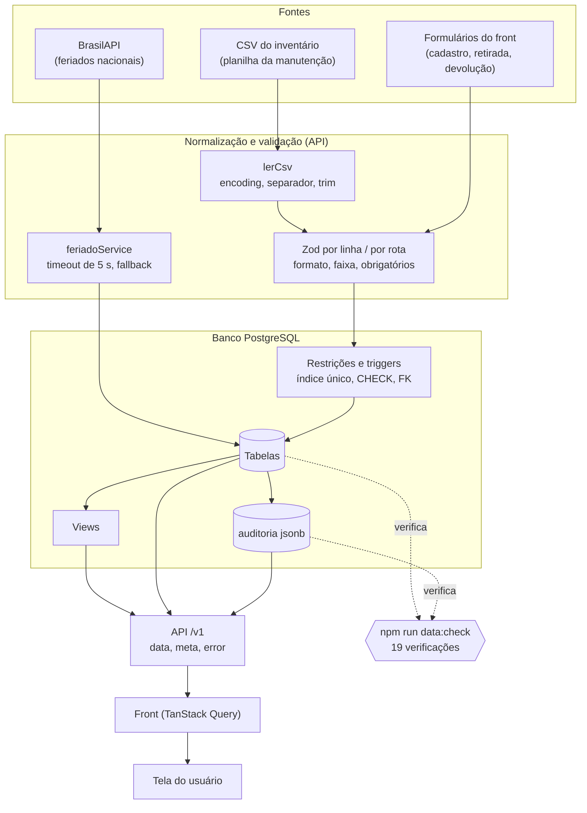

# 1. Contexto

Esta entrega atende à atividade do projeto de extensão do dia 20/10/2026, do Prof. Max Vallim:
**Transformação, Validação e Qualidade dos Dados**. O enunciado pede processos de tratamento,
validação e transformação das informações usadas na aplicação, de modo a garantir consistência e
confiabilidade dos dados, e quatro evidências: **validação dos dados**, **regras de negócio
implementadas**, **tratamento de inconsistências** e **documentação do fluxo de integração** entre as
fontes de dados e a aplicação.

O projeto é o **SOUFER Tools**, sistema web de controle de retirada e devolução de ferramentas do
setor de manutenção da Soufer (beneficiada do projeto de extensão; ODS 9 e, em segundo plano, 12). A
pessoa da manutenção registra quem retirou qual ferramenta, para que e até quando; na devolução,
informa a condição (ok, avaria ou perda). O valor do sistema está no dado: se o status de uma
ferramenta não bate com a realidade, ou se dois empréstimos abertos disputam o mesmo item, o
controle perde o sentido. Por isso esta entrega trata o dado como o produto principal.

A pilha que sustenta o dado: banco **PostgreSQL** com migrations versionadas (`0001` a `0014`),
API **Node.js 20 + Express** com validação **Zod** em todas as rotas de escrita, e front **React**
que consome a API pelo prefixo `/v1`. As regras de negócio inegociáveis (10 no total) ficam
parte no banco (índices únicos, `CHECK`, triggers) e parte na API (validação e permissões), de
propósito: a regra que importa é garantida no banco, e não só na tela.

## 1.1 Estado de partida

Uma auditoria do repositório (branch `feat/dados-validacao-qualidade`, a partir de
`development`, commit `43bf5a5`) mostrou que boa parte do que o enunciado pede já existia, mas
quatro pontos ainda faltavam ou estavam incompletos:

- **Já existia:** importação de CSV do inventário com relatório de linhas aceitas, rejeitadas e
  ignoradas; integração com a BrasilAPI de feriados (cache em tabela e fallback de sábado e
  domingo); validação Zod nas rotas; as 10 regras documentadas em `docs/regras-negocio.md`; triggers
  e índices únicos no banco; 38 arquivos de teste automatizado.
- **Faltava (1) — detecção de dado incoerente:** nada procurava, depois do fato, um status que não
  bate com os empréstimos, datas trocadas ou matrícula repetida. Só havia prevenção, não conferência.
- **Faltava (2) — rastreabilidade:** a tabela `auditoria` (jsonb) existia, mas recebia só
  gravações manuais de login, convite e "disponibilizar". Nenhuma alteração em `ferramentas`,
  `emprestimos` ou `ocorrencias` deixava rastro automático.
- **Faltava (3) — documentação do fluxo completo:** o documento de integração descrevia só as
  **origens** do dado (CSV legado e BrasilAPI), sem o caminho até a tela, e vários trechos de
  `regras-negocio.md` e do dicionário de dados tinham ficado para trás das últimas migrations.
- **Faltava (4) — evidências reprodutíveis:** a suíte de testes tinha falhas intermitentes que
  atrapalhavam qualquer prova: 24 testes caíam no banco local por uma migration não aplicada, e
  outros falhavam de forma aleatória por colisões entre arquivos de teste.

## 1.2 Escopo desta entrega

| Eixo do enunciado | O que foi entregue | Onde está |
|---|---|---|
| Tratamento e transformação | Pipeline de importação de CSV (encoding, separador, normalização, conversão de valor, deduplicação, relatório) e integração com a BrasilAPI | Seções 2.1 e 2.2 |
| Validação e evidências | Validação em três camadas (front, Zod, banco) e 19 casos reais de requisição inválida | Seções 2.3 e 4.4 |
| Regras de negócio | As 10 regras, com mapa regra → implementação → teste → verificação | Seções 2.4 e 4.6 |
| Tratamento de inconsistências | Prevenir (Zod e banco), detectar (`npm run data:check`), rastrear (auditoria em jsonb) e corrigir (relatório de importação) | Seções 2.5 e 4.1 a 4.3 |
| Fluxo de integração | Diagrama e explicação de cada etapa, da fonte à tela | Seção 3 |

# 2. O que foi feito

## 2.1 Fontes de dados e integração

O sistema recebe dado de três origens:

| Fonte | Natureza | Como entra | Onde fica |
|---|---|---|---|
| Inventário da manutenção | CSV/planilha sem padronização (nomes em caixa mista, espaços repetidos, valor em formato brasileiro) | `POST /v1/importacoes/ferramentas`, em ondas de até 5000 linhas | `ferramentas` |
| BrasilAPI (feriados nacionais) | API externa, JSON | `npm run db:feriados` e leitura sob demanda, com cache | `feriados` |
| Balcão da manutenção | Formulários (cadastro, retirada, devolução) | Rotas de escrita `/v1/*` | `ferramentas`, `emprestimos`, `ocorrencias`, `colaboradores` |

Os arquivos reais da manutenção chegaram na visita técnica de 01/09/2026 e a normalização ficou sob
responsabilidade da equipe, como combinado. A carga em ondas (máquinas e equipamentos maiores
primeiro, chaves depois) é o motivo do teto de 5000 linhas por arquivo.

## 2.2 Tratamento e transformação do dado

### Importação de CSV (`api/src/services/importacaoService.ts`)

O arquivo percorre estas etapas, nesta ordem:

1. **Leitura (`lerCsv`).** Decodifica UTF-8 e, se falhar, Windows-1252 (como o Excel em português
   salva); detecta o separador (`;` ou `,`); remove o BOM; apara cada célula; descarta linhas vazias
   ou só com separadores.
2. **Cabeçalho.** Normaliza (minúsculas, sem acento, espaço vira `_`), aceita apelidos (`grupo` vale
   `categoria`), recusa coluna obrigatória ausente e coluna repetida, e recusa arquivo acima de 5000
   linhas ou 2 MB.
3. **Normalização por linha.** Espaços repetidos viram um só; o nome é gravado em maiúsculas; o
   valor `1.234,56` ou `R$ 18,90` vira número; a matrícula `36` é completada para `0036`.
4. **Validação por linha (Zod).** Tamanho mínimo e máximo, valor dentro de `NUMERIC(10,2)`,
   categoria e setor resolvidos pelo nome para o id. A linha inválida **não bloqueia as válidas**.
5. **Deduplicação.** Contra o banco (nome + marca + modelo) e contra o próprio arquivo. Duplicada
   vira "ignorada", não erro: reenviar o mesmo arquivo é seguro.
6. **Carga transacional.** Uma transação por arquivo; cada `INSERT` dentro de um `SAVEPOINT`, então
   um erro do banco numa linha não derruba as demais. Um *advisory lock* impede duas importações
   simultâneas do mesmo recurso de gravarem o mesmo item.
7. **Relatório.** A resposta traz `resumo`, `aceitas`, `rejeitadas` (com os motivos) e `ignoradas`,
   o que permite montar um CSV só com as linhas a corrigir.

**Exemplo executado de verdade** (arquivo `importacao-exemplo.csv`, 8 linhas de dados):

| Linha | Como veio no arquivo | Resultado |
|---|---|---|
| 2 | `  zzevid_furadeira de impacto  ;…;Bosch;GSB 13;…;1.234,56` | **Aceita**: gravada como `ZZEVID_FURADEIRA DE IMPACTO`, valor `1234.56`, código `0082` gerado pelo banco |
| 3 | `ZZEVID_Chave de fenda   Phillips nº 2;…;R$ 18,90` | **Aceita**: espaços reduzidos, maiúsculas, valor `18.90` |
| 4 | categoria `Categoria Inexistente` | Rejeitada: `Categoria "Categoria Inexistente" não cadastrada` |
| 5 | valor `12,5,0` | Rejeitada: `Valor inválido (use o formato 1.234,56)` |
| 6 | nome `A` | Rejeitada: `Nome deve ter no mínimo 2 caracteres` |
| 7 | repete a linha 2 | Ignorada: `Repetida no arquivo (mesma da linha 2)` |
| 8 | valor `99999999999` | Rejeitada: `Valor deve ser no máximo 99.999.999,99` |
| 9 | ferramenta que já existe no banco | Ignorada: `Já cadastrada (código 1)` |

Resultado: `{ "total_linhas": 8, "aceitas": 2, "rejeitadas": 4, "ignoradas": 2 }`. Cada linha aceita deixou
uma linha de `INSERT` na auditoria, com o usuário do token. Depois do teste, os registros foram
removidos e a contagem de linhas de todas as tabelas voltou ao valor anterior.

### Integração com a BrasilAPI (`api/src/services/feriadoService.ts`)

- Chamada a `https://brasilapi.com.br/api/feriados/v1/{ano}` com timeout de 5 s; o resultado vai
  para a tabela `feriados` por *upsert* (`ON CONFLICT (data)`), que funciona como cache.
- A leitura prefere o cache; com o cache vazio, sincroniza; se a BrasilAPI falhar (rede ou HTTP),
  cai no **fallback de sábado e domingo** (regra 9) e responde `200` com `fonte:
  fallback_fim_de_semana`, sem gravar o fallback no cache.
- **Falha de banco não é mascarada:** se o erro é do Postgres, ele sobe como erro de verdade. Antes
  desta entrega o fallback não tinha teste; agora tem (seção 4.5).
- Evidência real: `npm run db:feriados -- 2026` gravou 14 feriados, e o cálculo de dias úteis os
  usa (7/9 e sábado devolvem `diaUtil: false`; uma segunda-feira comum, `true`).

## 2.3 Validação em três camadas

| Camada | O que valida | Exemplo | Resposta |
|---|---|---|---|
| Front (React) | Formato antes de enviar; arquivo CSV (tamanho, linhas, duplicadas) | Importação cancelável, com teto de linhas | Mensagem na tela |
| API (Zod) | Corpo, parâmetros e *query* de **todas** as rotas de escrita: tipos, faixas, obrigatórios, datas reais | Nome com 1 letra; `previsaoDevolucao` no passado; período de KPI invertido | `400 VALIDATION_ERROR` com `field`, `message` e `rule` |
| Banco (PostgreSQL) | O que não pode depender de uma tela: índice único parcial, `CHECK`, chave estrangeira, triggers | Segunda retirada da mesma ferramenta; matrícula fora de 4 dígitos | `409 FERRAMENTA_INDISPONIVEL`, `409 DUPLICATE_ENTRY`, `400 CHECK_VIOLATION` |

A razão das camadas: a validação do front melhora a experiência, a da API protege contra qualquer
cliente, e a do banco vale até para quem escreve fora da API (script, `psql`). O envelope de erro é
sempre o mesmo, `{ "error": { "code", "message", "details" } }`, e o *handler* global traduz os
erros do Postgres: `23505` vira `409`, `23503` vira `400`, `P0001` (trigger) vira `409
BUSINESS_RULE_VIOLATION` e, novidade desta entrega, `23514` (`CHECK`) vira `400 CHECK_VIOLATION`
sem vazar os valores da linha. JSON malformado responde `400 INVALID_JSON`.

## 2.4 Regras de negócio implementadas

As 10 regras da Seção 3 do guia do projeto estão documentadas, uma a uma, em `docs/regras-negocio.md`,
com o local da implementação, o que acontece se for violada e um exemplo real:

| # | Regra | Implementação | Se for violada |
|---|---|---|---|
| 1 | Um empréstimo aberto por ferramenta | Índice único parcial `uq_emprestimo_aberto` + trigger `fn_valida_retirada` | `409 FERRAMENTA_INDISPONIVEL` |
| 2 | Três estados; indisponível separado de em uso | Enum `status_ferramenta`; telas separadas | Erro de tipo do Postgres |
| 3 | Avaria ou perda abre ocorrência sozinha, herdando o colaborador | Triggers `fn_abre_ocorrencia` e `fn_sync_status_ferramenta` | Efeito automático, não há como contornar |
| 4 | Atividade opcional na retirada | Zod opcional + coluna sem `NOT NULL` | Não há violação possível |
| 5 | Identificação por matrícula ou nome; cadastro rápido | `identificar` (matrícula exata, depois nome com `unaccent` e `pg_trgm`) + `CHECK` de 4 dígitos | `404`, sinal para abrir o cadastro rápido |
| 6 | Responsável sempre do JWT | Validators sem o campo; `req.usuario.id` | O valor do corpo é descartado |
| 7 | Código de identificação gerado pelo banco (em revisão) | `fn_gera_codigo_identificacao` + *advisory lock*; índice único parcial | `409` ao esgotar os 9999 códigos |
| 8 | Três perfis (manutenção, admin, consulta) | `authorize()` por rota; token de consulta isolado | `403 ACCESS_DENIED` |
| 9 | Feriados da BrasilAPI com cache e fallback | `feriadoService` | Fallback; `502` só na sincronização forçada |
| 10 | Entrega fora do prazo ou impressa = nota zero | Regra institucional do curso | — |

Nesta entrega o documento foi revisado contra o código atual: as referências a testes passaram a
citar o **nome do teste** (que não muda quando o arquivo cresce), a matriz de permissões da regra 8
foi refeita rota a rota (o admin é a manutenção com recursos a mais), e o fallback da regra 9 e a
concorrência da regra 7, antes apontados como "sem teste", agora têm teste permanente.

## 2.5 Tratamento de inconsistências

A estratégia tem quatro camadas, da mais barata (impedir) à mais tardia (corrigir):

1. **Prevenir:** Zod na API e restrições no banco, que valem para qualquer caminho de escrita.
2. **Detectar:** `npm run data:check`, que aponta o que escapou (dado antigo, escrita direta, defeito).
3. **Rastrear:** auditoria automática em jsonb, para saber quem mudou o quê e o valor anterior.
4. **Corrigir:** o relatório da importação diz, linha a linha, o motivo da recusa, e o `data:check`
   diz como corrigir cada achado.

### Detecção: `npm run data:check` (`dataCheckService.ts`, `scripts/data-check.ts`)

Comando somente de leitura, com **19 verificações**, relatório legível no terminal, saída `0` quando
não há erro, `1` quando há e `2` se não conseguiu rodar (as flags `--json` e `--so-erros` servem a
CI e a leitura rápida). O comando **nunca corrige** nada. Verificações de gravidade **erro**
reprovam; as de **aviso** informam sem reprovar.

| Verificação | O que detecta | Gravidade |
|---|---|---|
| `EM_USO_SEM_EMPRESTIMO` | Ferramenta "em uso" sem empréstimo aberto | erro |
| `EMPRESTIMO_ABERTO_FERRAMENTA_NAO_EM_USO` | Empréstimo aberto de ferramenta que não está "em uso" | erro |
| `INDISPONIVEL_SEM_MOTIVO` | Indisponível sem o motivo gravado (regra 3) | erro |
| `FERRAMENTA_CODIGO_DUPLICADO` | Código de identificação repetido entre ativas | erro |
| `COLABORADOR_MATRICULA_DUPLICADA` | Matrícula repetida, ignorando maiúsculas e espaços | erro |
| `EMPRESTIMO_PREVISAO_ANTES_RETIRADA` | Previsão de devolução anterior à retirada | erro |
| `EMPRESTIMO_DEVOLUCAO_ANTES_RETIRADA` | Devolução anterior à retirada | erro |
| `FERRAMENTA_SUBGRUPO_FORA_DO_GRUPO` | Subgrupo que pertence a outro grupo | erro |
| `FERRAMENTA_VALOR_NEGATIVO` | Valor de aquisição negativo | erro |
| `FERRAMENTA_NOME_VAZIO` | Nome em branco | erro |
| `AUDITORIA_TRIGGER_AUSENTE` | Trigger de auditoria ausente ou desabilitada | erro |
| `MOTIVO_COM_STATUS_DIFERENTE` | Motivo de indisponibilidade em ferramenta que circula | aviso |
| `INDISPONIVEL_SEM_OCORRENCIA_ABERTA` | Indisponível por avaria ou perda sem ocorrência em andamento | aviso |
| `OCORRENCIA_ABERTA_FERRAMENTA_DISPONIVEL` | Ocorrência em andamento com a ferramenta disponível | aviso |
| `OCORRENCIA_SEM_COLABORADOR_COM_EMPRESTIMO` | Ocorrência de empréstimo sem o colaborador (regra 3) | aviso |
| `EMPRESTIMO_DEVOLVIDO_SEM_CONDICAO` | Devolvido sem a condição (ok, avaria, perda) | aviso |
| `EMPRESTIMO_COLABORADOR_INATIVO_ABERTO` | Empréstimo aberto de colaborador inativo | aviso |
| `FOTO_ARQUIVO_INEXISTENTE` | `foto_url` cujo arquivo não existe no disco | aviso |
| `AUDITORIA_SEM_REGISTRO` | Registro criado depois da auditoria sem nenhuma linha de auditoria | aviso |

Cada verificação é testada **forçando a inconsistência** dentro de uma transação que termina em
`ROLLBACK` (`dataCheck.test.ts`): nada vaza para o banco. Em duas delas o próprio banco já impede o
caso (código e matrícula repetidos); o teste prova que o banco **recusa** a gravação (erro `23505`) e
que a verificação roda limpa.

### Rastreio: auditoria automática em jsonb (migration `0014`)

- Triggers `AFTER INSERT OR UPDATE OR DELETE` em `ferramentas`, `emprestimos` e `ocorrencias`
  gravam em `auditoria`. `INSERT` guarda o registro inteiro; `UPDATE` guarda **só as colunas que
  mudaram** (antes e depois, nunca `updated_at`); `DELETE` guarda o registro apagado. Um `UPDATE` que
  não muda nada não gera linha.
- **Quem alterou** vem do JWT: a API informa o `usuario_id` ao banco no início de cada transação
  (`set_config('app.usuario_id', …)`), nunca a partir do corpo da requisição (regra 6). Escritas
  fora da API ficam com `usuario_id` nulo.
- As triggers participam da transação: se a escrita desfaz, a auditoria também desfaz. A devolução
  com avaria deixa **três trilhas encadeadas** (empréstimo, ferramenta e a ocorrência aberta
  sozinha). A tabela `usuarios` fica de fora de propósito, porque guarda `senha_hash`.
- Consulta: `GET /v1/auditoria` (só admin), com filtros por tabela, registro, operação, usuário e
  período, paginação e o nome de quem alterou.
- Custo: importar 1.000 ferramentas levou cerca de 3,9 s com a auditoria ligada e 3,8 s com ela
  desligada, diferença desprezível.

## 2.6 Estabilização da suíte de testes

Para que o resultado dos testes sirva de evidência, as falhas intermitentes foram investigadas até a
causa, sem esconder o sintoma com repetição:

| Sintoma | Causa | Correção |
|---|---|---|
| 24 testes falhando com `coluna foto_url não existe` | Migration `0013` não aplicada no banco local | `npm run db:migrate`; o README agora avisa para rodá-lo antes dos testes |
| `uq_ferramenta_codigo_ativo` e limpezas que falhavam ao acaso | Prefixos de dado de teste em que um era o começo do outro (a limpeza `LIKE 'ZZTESTE_API_FOTO_%'` de um arquivo apagava os registros de outro, que ainda estavam em uso); testes de carga estouravam o limite de 5 s com 40 arquivos em paralelo | Prefixos renomeados para não se sobreporem; `testTimeout` de 20 s |
| `emprestimoListagem` e `importacaoExportacaoCsv` falhavam conforme os dados do banco | Os testes comparavam totais gerais, que mudam quando outro teste grava em paralelo | Comparam só o que é determinístico |
| Concorrência do código de identificação sem teste | — | Teste com 12 inserções em paralelo, cada uma na sua conexão |

Resultado: **42 arquivos e 437 testes passando, em 5 execuções seguidas**.

# 3. Fluxo de integração dos dados



| De → Para | O que acontece | Se falhar |
|---|---|---|
| CSV → `lerCsv` | Decodifica, detecta separador, apara células, descarta linhas vazias | `400` "não foi possível ler o arquivo" |
| `lerCsv` → Zod | Normaliza cabeçalho e texto, converte valor, valida cada linha | Linha rejeitada com o motivo; as demais seguem |
| Formulário → Zod | Valida corpo, parâmetros e *query* da rota | `400 VALIDATION_ERROR` com `details` |
| Zod → regras do banco | `INSERT` com restrições e triggers; cada linha num `SAVEPOINT` | Linha rejeitada ou `409`/`400` com código de negócio |
| BrasilAPI → `feriadoService` | Timeout de 5 s, *upsert* em `feriados` | Fallback de sábado e domingo; erro de banco não vira fallback |
| Restrições → tabelas | Triggers atualizam o que depende (status da ferramenta, ocorrência) | A transação inteira desfaz |
| Tabelas → `auditoria` | Uma linha por alteração real, com o diff e o usuário do JWT | Desfaz junto com a escrita |
| Tabelas → views → API | Listagens e dashboard leem views (`vw_emprestimos_detalhe`, `vw_dashboard_kpis`) | `500` (em produção, sem detalhe) |
| API → front → tela | Envelope `{ data, meta }`; o front invalida o cache após cada escrita e mostra o erro da API | Falha de rede distinguida de recusa |
| Tabelas e auditoria → `data:check` | Consultas de leitura procuram o que as regras deveriam ter impedido | Saída `1` se houver erro |

O documento completo, com o caminho de cada seta no código, está em
`docs/banco-de-dados/fluxo-integracao.md`.

# 4. Evidências de validação

Todas as evidências abaixo foram geradas por execução real contra o banco de desenvolvimento
(script `evidencias/scripts/gerar-evidencias.mts`); os arquivos completos estão na pasta
`27-10-2026/evidencias/`. Os dados criados para as demonstrações levam o prefixo `ZZEVID_` e são
removidos ao final: a contagem de linhas de cada tabela voltou ao valor de antes.

## 4.1 `data:check` detectando inconsistências forçadas

Foram criados, de propósito, cinco registros incoerentes (ferramenta "em uso" sem empréstimo,
indisponível sem motivo, valor negativo, nome em branco e empréstimo com previsão anterior à
retirada). Saída do comando:

```text
🔎 SOUFER Tools — verificação de consistência dos dados
❌ EM_USO_SEM_EMPRESTIMO......................... 1
     Ferramenta "em uso" sem empréstimo aberto
     • nome=ZZEVID_em uso sem emprestimo  ferramenta_id=…  codigo_identificacao=82
     Como corrigir: Conferir o histórico da ferramenta; se ela está na bancada, ...
❌ INDISPONIVEL_SEM_MOTIVO....................... 1
❌ EMPRESTIMO_PREVISAO_ANTES_RETIRADA............ 1
❌ FERRAMENTA_VALOR_NEGATIVO..................... 1
❌ FERRAMENTA_NOME_VAZIO......................... 1
Resumo: 19 verificações · 12 ok · 5 com erro · 2 com aviso
Resultado: PROBLEMAS ENCONTRADOS (saída 1)
```

Depois de remover os registros de teste, o mesmo comando:

```text
Resumo: 19 verificações · 17 ok · 0 com erro · 2 com aviso
Resultado: tudo certo (saída 0)
```

Contagem de linhas antes e depois: ferramentas 101 → 101, empréstimos 342 → 342, ocorrências
45 → 45, colaboradores 69 → 69. Os 2 avisos que permanecem são dados reais de teste do ambiente de
desenvolvimento (6 ferramentas `ZZINSOMNIA` criadas pela coleção do Insomnia sem ocorrência aberta e
4 fotos cujo arquivo não existe mais no disco): o `data:check` os encontra, como deve.

## 4.2 Importação de CSV: o relatório

A tabela da seção 2.2 mostra cada linha do arquivo e seu destino. O corpo da resposta da API
(trecho):

```json
{
  "resumo": { "total_linhas": 8, "aceitas": 2, "rejeitadas": 4, "ignoradas": 2 },
  "rejeitadas": [
    { "linha": 4, "motivos": ["Categoria \"Categoria Inexistente\" não cadastrada"] },
    { "linha": 5, "motivos": ["Valor inválido (use o formato 1.234,56)"] },
    { "linha": 6, "motivos": ["Nome deve ter no mínimo 2 caracteres"] },
    { "linha": 8, "motivos": ["Valor deve ser no máximo 99.999.999,99"] }
  ],
  "ignoradas": [
    { "linha": 7, "motivo": "Repetida no arquivo (mesma da linha 2)" },
    { "linha": 9, "motivo": "Já cadastrada (código 1)" }
  ]
}
```

## 4.3 Auditoria: uma devolução com avaria

Fluxo executado pela API: criar a ferramenta, retirar, devolver com avaria (enviando, de propósito,
`usuarioDevolucaoId: 999999` no corpo) e editar a localização. Trilha lida em `GET /v1/auditoria`
(trecho da ferramenta; cada `UPDATE` traz só as colunas que mudaram):

```json
[
  { "operacao": "INSERT", "dados_novos": "(registro completo)" },
  { "operacao": "UPDATE",
    "dados_anteriores": { "status": "disponivel" },
    "dados_novos":      { "status": "em_uso" } },
  { "operacao": "UPDATE",
    "dados_anteriores": { "status": "em_uso", "motivo_indisponivel": null },
    "dados_novos":      { "status": "indisponivel",
                          "motivo_indisponivel": "avaria" } },
  { "operacao": "UPDATE",
    "dados_anteriores": { "localizacao": null },
    "dados_novos":      { "localizacao": "Armário 7" } }
]
```

O empréstimo e a ocorrência (aberta sozinha pela trigger, herdando o colaborador) têm trilhas
próprias, todas com o usuário do token. **Prova da regra 6:** o `usuario_devolucao_id` gravado foi o
do token, e não o `999999` enviado no corpo.

## 4.4 Validação nas rotas de escrita: 19 casos reais

Cada requisição inválida abaixo foi executada contra a API; todas devolvem o envelope padrão de
erro (`error.code`, `message`, `details`).

| # | Caso | HTTP | `error.code` |
|---|---|---|---|
| 1 | Ferramenta com nome de 1 letra | 400 | VALIDATION_ERROR |
| 2 | Ferramenta sem categoria | 400 | VALIDATION_ERROR |
| 3 | Colaborador com matrícula inválida | 400 | VALIDATION_ERROR |
| 4 | Retirada sem previsão de devolução | 400 | VALIDATION_ERROR |
| 5 | Retirada com previsão no passado | 400 | VALIDATION_ERROR |
| 6 | Retirada de ferramenta inexistente | 404 | FERRAMENTA_NOT_FOUND |
| 7 | Retirada com JSON malformado | 400 | INVALID_JSON |
| 8 | KPI com período invertido | 400 | VALIDATION_ERROR |
| 9 | KPI com data impossível (30 de fevereiro) | 400 | VALIDATION_ERROR |
| 10 | Auditoria com tabela desconhecida | 400 | VALIDATION_ERROR |
| 11 | Auditoria sem token | 401 | TOKEN_NOT_PROVIDED |
| 12 | Auditoria com perfil manutenção (só admin) | 403 | ACCESS_DENIED |
| 13 | Edição de ferramenta pela manutenção (só admin) | 403 | ACCESS_DENIED |
| 14 | Perfil consulta tentando rota de balcão | 403 | ACCESS_DENIED |
| 15 | Importação de CSV sem a coluna obrigatória | 400 | VALIDATION_ERROR |
| 16 | Importação de recurso desconhecido | 400 | VALIDATION_ERROR |
| 17 | Segunda retirada da mesma ferramenta (regra 1) | 409 | FERRAMENTA_INDISPONIVEL |
| 18 | Devolução com condição inexistente | 400 | VALIDATION_ERROR |
| 19 | Devolução "ok" com custo estimado | 400 | VALIDATION_ERROR |

Exemplo de resposta completa (caso 1):

```json
{ "error": { "code": "VALIDATION_ERROR", "message": "Erro de validação nos dados enviados",
    "details": [ { "field": "nome", "message": "Nome deve ter no mínimo 2 caracteres", "rule": "too_small" } ] } }
```

## 4.5 Testes automatizados

`npm test` (Vitest + Supertest) contra o banco de desenvolvimento: **42 arquivos, 437 testes, todos
passando**. Os arquivos novos desta entrega:

| Arquivo | O que cobre |
|---|---|
| `dataCheck.test.ts` | Cada uma das 19 verificações, forçada numa transação revertida; falha isolada de uma verificação; códigos de saída; comando em `--json` |
| `auditoria.test.ts` | `INSERT`, `UPDATE` só com o diff, `UPDATE` sem mudança, `DELETE`, usuário do `set_config`, *rollback*, trilhas encadeadas e fluxo completo pela API |
| `auditoriaRoutes.test.ts` | `GET /v1/auditoria`: 401/403, filtros, paginação e filtros inválidos |
| `feriadoFallback.test.ts` | BrasilAPI com erro de rede e HTTP, fallback de 104 dias, cache com *upsert*, falha de banco não mascarada |
| `errorHandler.test.ts` (ampliado) | `23514` vira `400 CHECK_VIOLATION` sem vazar valores |
| `ferramentaCodigo.test.ts` (ampliado) | 12 inserções simultâneas recebem códigos distintos |

## 4.6 Mapa regra → teste → evidência

O arquivo `evidencias/09-matriz-regras-evidencias.md` liga cada uma das 10 regras à implementação, ao
teste que a prova (com o nome do teste) e ao arquivo de evidência. Exemplo, regra 1: índice
`uq_emprestimo_aberto` e trigger `fn_valida_retirada` → teste `recusa ferramenta já emprestada com
409 FERRAMENTA_INDISPONIVEL` → caso 17 da seção 4.4 e verificação `EM_USO_SEM_EMPRESTIMO`.

# 5. Documentação produzida e atualizada

| Documento | O que mudou |
|---|---|
| `docs/banco-de-dados/fluxo-integracao.md` | Fluxo completo com diagrama, cada etapa explicada, exemplo ponta a ponta e tabela de tratamento de inconsistências |
| `docs/regras-negocio.md` | Referências conferidas contra o código, matriz de permissões refeita, regras 7 e 9 atualizadas, seções de rastreabilidade e mapa regra → teste |
| `docs/banco-de-dados/dicionario-de-dados.md` | Migrations `0008` a `0014`: `convites_acesso`, `schema_migrations`, colunas novas, auditoria por trigger; campo `etiqueta_impressa_em`, que faltava |
| `docs/banco-de-dados/der.dbml` e `der-documentacao.md` | Tabelas e colunas novas (o PNG do DER precisa ser regerado manualmente a partir do `.dbml`) |
| `docs/backend/api.md` e `processos.md` | Rota `GET /v1/auditoria`; seções de auditoria e de `data:check` |
| `api/README.md` | Comando `npm run data:check` e o aviso para rodar `db:migrate` antes dos testes |
| `docs/entregas-pi/…/27-10-2026/evidencias/` | Nove arquivos de evidência, o CSV de exemplo e o script que os gera |

# 6. Como reproduzir

Dentro de `api/`, com o banco de desenvolvimento acessível:

```bash
npm run db:migrate          # aplica as migrations pendentes (inclui a 0014, de auditoria)
npm test                    # 42 arquivos, 437 testes
npm run data:check          # verificação de consistência (sai com 1 se houver erro)
npm run data:check -- --json --so-erros
npx tsx ../docs/entregas-pi/integracao-de-dados-max-vallim/27-10-2026/evidencias/scripts/gerar-evidencias.mts
```

# 7. Limitações e próximos passos

- **Importação pelo front ainda é linha a linha.** O `ImportarCsvDialog` lê o arquivo no navegador e
  envia uma requisição por linha às rotas normais (cada uma passa pelo Zod e pelo banco). O
  endpoint em lote `POST /v1/importacoes/:recurso` está pronto, testado e documentado; a troca no
  front está descrita em `docs/backend/import/importacao-front.md`.
- **Auditoria sem tela.** Existe a rota `GET /v1/auditoria` (só admin), mas não há tela de consulta.
  A tabela cresce com o uso; uma política de retenção fica como próximo passo.
- **`data:check` fora do CI.** O comando já devolve código de saída adequado e `--json`, mas ainda
  não roda no pipeline do repositório.
- **Dados de teste no ambiente de desenvolvimento.** Os 2 avisos do `data:check` (ferramentas
  `ZZINSOMNIA` e fotos sem arquivo) são resíduo de testes e podem ser limpos pela equipe.
- **Regra 7 em revisão.** O código de identificação de 4 dígitos funciona e é testado, mas a decisão
  entre etiqueta e gravação a lápis elétrico ainda depende de ata.
- **Evidências de tela.** Prints do front (tela de importação com o relatório de rejeição e uma
  mensagem de erro de validação) precisam ser tirados à mão e anexados em `evidencias/prints/`.
- **DER em imagem.** O PNG do DER ainda é o da revisão de 02/09; o `.dbml` já está atualizado.

# 8. Resultado

O SOUFER Tools passou a ter, para a qualidade dos dados, as três funções que faltavam além de
validar: **detectar** (`data:check`, 19 verificações, cada uma testada com a inconsistência forçada),
**rastrear** (auditoria automática em jsonb nas três tabelas críticas, com o usuário vindo do JWT) e
**provar** (437 testes estáveis e nove arquivos de evidência gerados por execução real). O fluxo
completo, da planilha e da BrasilAPI até a tela, está documentado com diagrama, as 10 regras têm
mapa até o teste e as inconsistências têm um caminho de ponta a ponta: barrar, detectar, rastrear e
corrigir. O que ficou para depois está listado na seção 7, sem esconder nenhum ponto.
