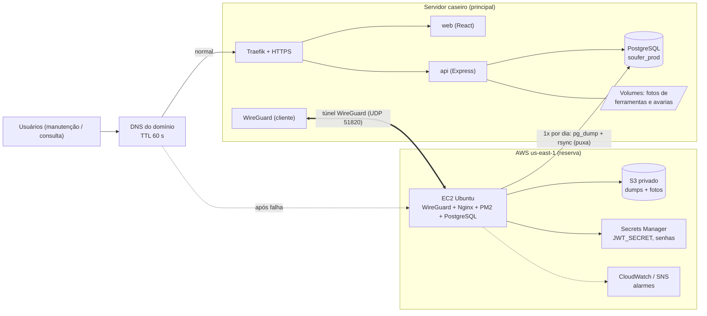

# Ponte Servidor Caseiro ↔ AWS: backup diário e failover

**Projeto:** SOUFER Tools (PI 2026.2)
**Status:** proposta da equipe, ainda não implantada
**Relacionados:** [`dokploy.md`](dokploy.md) (servidor caseiro), [`infra-plano.md`](infra-plano.md) (plano de nuvem),
[`custos-nuvem.md`](custos-nuvem.md) (custos) e o nosso guia "Como enviar o projeto para a AWS" (EC2 atual)

---

## 1. Resumo da proposta

O SOUFER Tools já roda em produção no nosso servidor caseiro (Dokploy) e, em paralelo, já colocamos uma cópia do
sistema numa instância EC2 da AWS. Queremos ligar as duas pontas: a AWS passa a guardar uma cópia diária do que está
no servidor caseiro e, se ele cair, a EC2 entra no lugar. Também precisamos decidir se dá para fazer tudo dentro da
EC2 ou se vale usar outros serviços da AWS. Este documento descreve o que pretendemos montar e o que ainda precisamos
levantar.

| Pergunta | Nossa resposta |
|---|---|
| O que é o sistema "principal"? | O **servidor caseiro** (Dokploy + Docker + Traefik + PostgreSQL em contêiner). |
| Qual o papel da AWS? | Guardar **cópia diária** do que está no servidor caseiro e **assumir o serviço** se ele cair. |
| Dá para fazer tudo dentro da EC2? | **Dá**, e é o caminho mais barato e o que já dominamos. Mas só a EC2 deixa três buracos: o backup fica no mesmo disco, não há alarme independente e o DNS não troca sozinho. |
| Quais serviços AWS a mais valem a pena? | **S3** (cofre dos backups) e **SNS/CloudWatch** (alerta). **Route 53** só se o Learner Lab liberar; senão, a API de atualização do provedor de DNS do `servidorcaseiro.online` (a confirmar). Detalhes na seção 4. |
| Como a EC2 fala com a casa? | Por um **túnel WireGuard** iniciado pela casa (funciona atrás de roteador/CGNAT, sem abrir porta no roteador). |
| Quem puxa o backup? | A **EC2 puxa** do servidor caseiro. Assim a casa não precisa guardar chave da AWS (no Learner Lab as credenciais expiram e não dá para criar usuário IAM). |
| Quanto custa? | Standby "frio" (EC2 desligada, só liga se a casa cair): **~US$ 5,75/mês**. Standby "quente" (EC2 sempre ligada): **~US$ 36/mês**. Ver seção 9. |
| Maior risco | O **AWS Academy Learner Lab desliga a sessão em ~4 h** (como registramos no nosso guia de deploy). Para a apresentação serve como demonstração; para uso real na Soufer vamos precisar de uma conta AWS própria. Ver seção 2. |

**Nossa recomendação:** vamos começar pela Fase 1 (túnel, backup diário para o S3, restauração testada e roteiro
manual de troca) e só depois automatizar a troca (Fase 2). A replicação contínua do banco (Fase 3) fica como "se
sobrar tempo".

---

## 2. Premissas e limites

1. **Servidor caseiro** (entrega de 13/10/2026): Dokploy v0.30.2 com 7,65 GiB de memória e 112 GB de disco
   (98 GB já ocupados naquela data), HTTPS pelo Traefik, conforme o nosso guia [`dokploy.md`](dokploy.md). Temos dois
   ambientes no mesmo servidor: **produção** (branch `main`; front em `soufer-tools.servidorcaseiro.online`, API em
   `api-soufer.servidorcaseiro.online`, banco `soufer_prod`) e **desenvolvimento** (branch `development`; banco
   `soufer_dev`). Na data, produção tinha 192 ferramentas e 113 colaboradores. A porta 3000 da API **não** é
   publicada (exigência do `TRUST_PROXY_HOPS=1`). Como o disco da casa está quase cheio, **não** vamos guardar os
   backups lá: eles ficam na EC2 e no S3.
2. **EC2 atual** (nosso guia de deploy, Partes 1 a 9): Ubuntu 24.04, `t3.medium`, Nginx + API Node (PM2) + PostgreSQL 16 +
   front estático, Elastic IP `32.202.0.79`, segredos no Secrets Manager (`soufer-tools/prod`) e `LabRole`.
3. **Learner Lab:** a sessão dura cerca de 4 horas, só existe a `LabRole`, e as credenciais temporárias rotacionam.
   Consequências:
   - não temos garantia de failover **24 h por dia** enquanto estivermos no Lab (a EC2 para quando o Lab é encerrado);
   - não conseguimos criar um usuário IAM com chave fixa para o servidor caseiro enviar arquivos ao S3;
   - serviços como Route 53, SNS, EventBridge e Lambda **podem** estar bloqueados: vamos testar antes de depender deles.
4. Em uma conta AWS real da Soufer, nada disso vale: lá podemos usar usuário IAM com permissão mínima, Route 53 e Lambda.
5. **Orientações do PI:** conferimos o PDF de orientações. Ele exige entrega digital, código e documentação no GitHub
   e demonstração funcional, e esta proposta não conflita com nada disso. Para a apresentação (23 a 27/11) precisamos
   da aplicação acessível e, se der tempo, de uma demonstração do backup e da troca.

---

## 3. Arquitetura proposta



**Fluxo normal:** o usuário abre `https://soufer-tools.servidorcaseiro.online`, o DNS aponta para a casa e a EC2 só
puxa o backup.
**Fluxo de falha:** o vigia detecta que a casa não responde, a EC2 restaura e ativa o banco e a API, e o DNS passa a
apontar para o Elastic IP da EC2.

---

## 4. Tudo na EC2 ou com outros serviços da AWS?

| Função | Só na EC2 | Com serviço AWS | Nossa escolha |
|---|---|---|---|
| Rodar API, front e banco de reserva | Sim (já está pronto) | RDS/S3+CloudFront custam mais e mudam a stack | **EC2** |
| Agendar o backup diário | `systemd timer` ou cron | EventBridge | **EC2** (mais simples) |
| Guardar os backups | Disco da própria EC2 (se a EC2 morrer, perde junto) | **S3** (US$ 0,023/GB-mês, versionamento, criptografia) | **S3** (cópia fora do disco) |
| Segredos (`JWT_SECRET`, senhas) | `.env` com `chmod 600` | **Secrets Manager** (já em uso) | **Secrets Manager** |
| Detectar que a casa caiu | Script na EC2 (quem vigia e quem assume é o mesmo; se a EC2 cair, ninguém avisa) | CloudWatch Alarm / Route 53 Health Check / monitor externo | Script na EC2 **+** um monitor externo gratuito (ex.: UptimeRobot) para avisar a gente |
| Avisar o grupo | e-mail via script | **SNS** | SNS se liberado; senão webhook do Discord/WhatsApp pelo script |
| Trocar o DNS | API do provedor de DNS chamada pelo script | **Route 53** (failover automático com health check) | Route 53 se liberado; senão API do provedor de DNS atual + script |
| Ligar a EC2 só na falha (standby frio) | Impossível (ela mesma está desligada) | EventBridge + Lambda, ou o script rodar em outra máquina | Só em conta real. No Lab, usar standby "quente" ou ligar à mão |

Conclusão: ficamos com **EC2 + S3 + Secrets Manager** como conjunto mínimo. O resto é opcional e depende do que o Lab liberar.

---

## 5. Conectividade: o túnel

- **Tecnologia:** WireGuard (leve, uma chave por ponta, UDP 51820). Se o WireGuard der trabalho, a alternativa é o Tailscale
  (gratuito para uso pessoal), com a mesma ideia.
- **Quem conecta:** o servidor caseiro **disca para a EC2** (o Elastic IP é fixo; a casa tem IP dinâmico/CGNAT).
  Vamos usar `PersistentKeepalive = 25` no lado da casa.
- **Rede do túnel:** `10.8.0.0/24` (EC2 = `10.8.0.1`, casa = `10.8.0.2`).
- **Security Group da EC2:** abrir **UDP 51820** (origem qualquer, pois o IP da casa muda). SSH continua como está.
- **Firewall da casa:** só vamos aceitar do túnel (`10.8.0.1`) a porta do PostgreSQL e o SSH usado no rsync.
- **PostgreSQL da casa:** o serviço `soufer-postgres` do Dokploy vai precisar de porta externa publicada **apenas no
  IP do túnel** (ex.: `10.8.0.2:5432`), nunca em `0.0.0.0`.
  Vamos criar um papel **somente leitura** para o backup:

  ```sql
  CREATE ROLE backup_ro LOGIN PASSWORD '<senha forte, só letras e números>';
  GRANT CONNECT ON DATABASE soufer_prod TO backup_ro;
  GRANT USAGE ON SCHEMA public TO backup_ro;
  GRANT SELECT ON ALL TABLES IN SCHEMA public TO backup_ro;
  GRANT SELECT ON ALL SEQUENCES IN SCHEMA public TO backup_ro;
  ALTER DEFAULT PRIVILEGES IN SCHEMA public GRANT SELECT ON TABLES TO backup_ro;
  ```

  Isso combina com a pendência que registramos na entrega de 13/10 ("remover a porta externa do banco"): sai a
  porta aberta para qualquer origem e entra uma publicada só no IP do túnel.

  > As migrations criam tabelas novas com o dono `postgres`/`soufer`; o `ALTER DEFAULT PRIVILEGES` precisa ser
  > executado **pelo papel que roda as migrations**, senão tabelas novas ficam fora do backup. Vamos validar com
  > `pg_dump` após a próxima migration.
- **Versão do `pg_dump`:** o cliente da EC2 precisa ser **igual ou mais novo** que o PostgreSQL da casa. Vamos conferir a
  imagem usada no Dokploy (`SELECT version();`) antes de fechar a versão na EC2.

---

## 6. Backup diário (a EC2 puxa)

### 6.1 O que entra no backup

| Item | De onde vem | Como | Observação |
|---|---|---|---|
| Banco `soufer_prod` | PostgreSQL da casa | `pg_dump -Fc` pelo túnel | Formato custom, restaura com `pg_restore`. Contém hash bcrypt e dados de colaboradores: tratar como dado sensível (LGPD). |
| Fotos de ferramentas | `UPLOADS_DIR` (`/app/data/ferramentas`) | `rsync` pelo túnel | Volume Docker do Dokploy: falta descobrir o caminho real no host. |
| Fotos de avaria/perda | `AVARIAS_DIR` (`/app/data/avarias`) | `rsync` pelo túnel | Idem. |
| Variáveis da API | Dokploy → Environment | Cópia manual, **uma vez**, para o Secrets Manager e o `.env` da EC2 | Não vai para o S3 em texto puro. |
| Versão do código | Branch/commit em produção na casa | Registrar no nome do backup (`git rev-parse` ou tag) | A EC2 precisa subir a **mesma versão** do dump (as migrations conferem o esquema). |

### 6.2 Rotina

1. Um `systemd timer` na EC2 roda todo dia às **03:30** (fora do horário da manutenção).
2. Ele puxa o dump e valida com `pg_restore -l` (arquivo ilegível = falha e alerta).
3. Sincroniza as pastas de fotos.
4. Envia tudo para o **S3** (`aws s3 cp` com criptografia `AES256`), em `s3://soufer-tools-backup-<sufixo>/AAAA-MM-DD/`.
5. Mantém **14 dias** no disco da EC2 e **30 dias** no S3 (regra de ciclo de vida).
6. Registra sucesso ou falha em log e nos avisa em caso de falha.

### 6.3 Restauração (vamos testar antes de confiar)

```bash
sudo -u postgres createdb -O soufer soufer_prod
pg_restore -h 127.0.0.1 -U soufer -d soufer_prod --no-owner --clean --if-exists soufer_AAAA-MM-DD.dump
cd ~/PI-2026.2/api && scripts/com-segredos.sh npm run db:migrate   # idempotente: só aplica o que faltar
```

> **Teste de restauração obrigatório:** vamos restaurar um dump real na EC2 e conferir a contagem de ferramentas,
> empréstimos e colaboradores contra a casa. Backup que nunca foi restaurado não conta como backup.

### 6.4 Alternativa: backup nativo do Dokploy

A aba de backups do Dokploy ainda está sem destino (pendência da entrega de 13/10). Ele agenda backup do banco para
um destino S3, o que funcionaria, **mas** exige uma chave de acesso fixa da AWS e o Learner Lab não oferece isso. Em
conta real essa seria a opção mais simples; no Lab, ficamos com o modelo "EC2 puxa".

---

## 7. Failover: como a EC2 assume

### 7.1 Detecção

- O vigia na EC2 (`systemd timer` a cada 30 s) vai consultar **`https://api-soufer.servidorcaseiro.online/v1/health`** pela internet pública
  (o mesmo caminho do usuário) e conferir `"status":"ok"`.
- **Gatilho:** 6 falhas seguidas (≈ 3 minutos) **e** nenhum sinal de vida da casa no túnel (handshake do WireGuard
  parado). Se só o túnel caiu e o site público responde, **não troca**: só nos avisa.
- Um **monitor externo** (UptimeRobot ou CloudWatch Synthetics) avisa o grupo, porque se a própria EC2 estiver
  fora ninguém percebe.

### 7.2 Promoção (o que a EC2 vai fazer)

1. Avisa o grupo: "iniciando assunção".
2. Restaura o último dump (se o standby não estiver com banco já carregado) e roda `db:migrate`.
3. Sobe a API com `scripts/com-segredos.sh` (mesmos `JWT_SECRET` e `DB_PASSWORD` do Secrets Manager).
4. Confere `curl http://127.0.0.1:3000/v1/health` e `curl -I https://reserva.servidorcaseiro.online/`.
5. Atualiza o DNS para o Elastic IP da EC2.
6. Grava a marca `/var/lib/soufer/MODO_RESERVA_ATIVO` e avisa o grupo com a hora do último backup, para sabermos o que pode ter se perdido.

### 7.3 Pontos que podem quebrar a troca e como vamos tratá-los

| Ponto | Problema | Solução |
|---|---|---|
| **Domínio** | A EC2 atual usa `sslip.io`, cujo nome embute o IP (`32-202-0-79.sslip.io`) e não aceita outro destino. A casa já usa um domínio real (`servidorcaseiro.online`). | Reutilizar o `servidorcaseiro.online`: na falha, os mesmos nomes (`soufer-tools.` e `api-soufer.`) passam a apontar para o Elastic IP. Vamos baixar o TTL desses registros para 60 s e descobrir se o provedor de DNS tem API. |
| **Dois nomes na casa, um na EC2** | Na casa o front e a API têm hostnames separados e `VITE_API_URL` absoluta; o front da EC2 é compilado com `/v1` relativo. | O Nginx da EC2 vai atender **os dois** hostnames (front e `/v1` em ambos) e a API da EC2 recebe `CORS_ORIGIN=https://soufer-tools.servidorcaseiro.online`. Assim abas antigas, com o front em cache, continuam funcionando. |
| **Certificado HTTPS na EC2** | O Let's Encrypt por HTTP-01 só emite se o DNS já apontar para a EC2, e no momento da falha é tarde. | Emitir o certificado da EC2 **antes**, por **DNS-01** (plugin do provedor de DNS), ou manter um nome próprio para a reserva (`reserva.servidorcaseiro.online`) já com certificado. |
| **`JWT_SECRET` diferente** | Todo mundo seria deslogado (sessões de 7 dias). | Usar o **mesmo** `JWT_SECRET` nos dois lados (copiar uma vez para o Secrets Manager). |
| **`TRUST_PROXY_HOPS`** | Sem `1`, o limite de tentativas de login passa a valer para todos juntos. | O Nginx da EC2 já exige `TRUST_PROXY_HOPS=1`; vamos manter. |
| **Versões diferentes** | A produção da casa acompanha a `main` por deploy automático (webhook); a EC2 só atualiza com `git pull` manual. O dump pode ter migration que a EC2 não conhece. | Antes de restaurar, atualizar a EC2 para o mesmo commit da `main` e registrar o commit no nome do backup. |
| **Seed** | Rodar `db:seed` na reserva cria contas `123456`. | Nunca rodar; a API já recusa com `NODE_ENV=production`. |
| **Notificações e feriados** | Os jobs da API (BrasilAPI, notificações) rodam nos dois lados e duplicam. | Manter a API da reserva **desligada** até a promoção. |

---

## 8. Volta para a casa (failback)

Decidimos que a volta **nunca é automática**: se a casa reaparecer sozinha com o banco de ontem, ela sobrescreveria o que a
EC2 gravou (dois "principais" ao mesmo tempo, o chamado *split-brain*).

1. Casa de volta e estável (conferimos a saúde por algumas horas).
2. Avisamos a manutenção da janela; a API da EC2 é parada.
3. `pg_dump` da EC2 → restaurar no PostgreSQL da casa (substitui o banco antigo); copiar as fotos de volta.
4. Conferimos contagens e `GET /v1/health` na casa.
5. Apontamos o DNS de volta para a casa, mantemos a EC2 parada e removemos a marca `MODO_RESERVA_ATIVO`.
6. Retomamos o backup diário.

---

## 9. Metas e custos

### 9.1 O quanto podemos perder e quanto demora a troca

| Nível | Como | Perda máxima (RPO) | Tempo de troca (RTO) | Esforço |
|---|---|---|---|---|
| **A. Diário (plano inicial)** | 1 dump por dia às 03:30 | até **24 h** de retiradas/devoluções | **~10 a 15 min** (restaura + sobe) | Baixo |
| **B. A cada hora** | mesmo script, `OnCalendar=hourly` | até **1 h** | ~10 a 15 min | Baixo (banco pequeno: dump leve) |
| **C. Replicação contínua** | Replicação lógica/streaming do PostgreSQL pelo túnel | **segundos** | **~3 a 5 min** (banco já está pronto) | Alto (config. de `wal_level`, slots, monitoramento) |

> Como o sistema controla **quem está com qual ferramenta**, perder um dia inteiro de movimentação é um problema:
> a ferramenta apareceria como "disponível" no sistema restaurado, mas estaria na mão de alguém. O nível **B** custa
> quase nada e reduz a perda a 1 hora, então queremos adotá-lo já na Fase 1. Se o grupo preferir manter "1 por dia",
> vamos registrar essa perda como risco aceito na ata.

### 9.2 Rateio de custos (us-east-1, sob demanda, cotação US$ 1 = R$ 5,50)

Os valores de EC2, EBS, IP e Secrets vêm do nosso guia de deploy (Anexo A). S3, Route 53 e domínio são **estimativas
que ainda vamos confirmar** em [calculator.aws](https://calculator.aws/) antes de ir para o relatório.

| Componente | Standby frio (EC2 desligada) | Standby quente (EC2 ligada 24 h) |
|---|---|---|
| EC2 `t3.medium` | só nas horas de uso (US$ 0,0416/h) | US$ 30,37 |
| EBS gp3 20 GiB | US$ 1,60 | US$ 1,60 |
| Elastic IP (IPv4 público) | US$ 3,65 | US$ 3,65 |
| Secrets Manager (1 segredo) | US$ 0,40 | US$ 0,40 |
| S3 (≈ 2 a 5 GB, 30 dias de retenção) | ≈ US$ 0,10 | ≈ US$ 0,10 |
| Route 53 (zona + 1 health check), opcional | ≈ US$ 1,25 | ≈ US$ 1,25 |
| Domínio `.com.br`, opcional | ≈ R$ 40/ano (≈ R$ 3,30/mês) | ≈ R$ 3,30/mês |
| **Total AWS (sem Route 53 e domínio)** | **≈ US$ 5,75 (≈ R$ 32)** | **≈ US$ 36,12 (≈ R$ 199)** |
| **Rateio por integrante (÷ 4)** | **≈ R$ 8** | **≈ R$ 50** |

- Uma `t3.small` (US$ 0,0208/h ≈ US$ 15,18/mês; confirmar) deve bastar para este volume e cortaria o standby quente quase pela metade (vamos testar).
- No Learner Lab o gasto sai do **crédito do lab**, não do nosso bolso; o rateio só vale quando migrarmos para uma conta real.
- O Elastic IP é cobrado mesmo com a EC2 parada: não vamos liberá-lo enquanto o domínio apontar para ele.

---

## 10. Segurança

- **Nada de segredo no repositório:** senhas, chaves do WireGuard, `JWT_SECRET` e links de convite ficam no
  Secrets Manager ou num `.env` com `chmod 600`.
- PostgreSQL da casa **nunca** exposto à internet: só na interface do túnel, com `backup_ro` somente leitura.
- Bucket S3 **privado**, bloqueio de acesso público ligado, criptografia ligada, versionamento ligado.
- A EC2 de reserva só terá as portas 22, 80, 443 e UDP 51820, com o SSH restrito aos nossos IPs.
- Backup contém dados de colaboradores (nome, matrícula): acesso só a quem administra; **não** vamos copiar
  dump para máquinas pessoais sem necessidade.
- Rotação: se a chave do túnel vazar, geramos um par novo nos dois lados; se o `JWT_SECRET` mudar, todos os usuários
  precisam entrar de novo.

---

## 11. Plano de execução

Cada item abaixo vira uma issue no nosso board do GitHub (ainda sem numeração).

### Fase 1: backup e restauração comprovados (prioridade, para o Dia Maker)
- [ ] Levantar os dados que faltam do servidor caseiro (seção 12).
- [ ] Criar o bucket S3 privado e a regra de ciclo de vida (30 dias).
- [ ] Montar o túnel WireGuard casa → EC2; testar `ping` e reconexão após queda.
- [ ] Criar `backup_ro` e publicar o PostgreSQL da casa **só** no IP do túnel.
- [ ] Escrever e agendar `backup-pull.sh` (dump + fotos + S3) com `systemd timer`.
- [ ] **Restaurar um dump real na EC2 e comparar contagens.** Registrar a evidência (prints e log).
- [ ] Documentar o roteiro manual de troca (seção 7.2) e ensaiar uma vez, cronometrando o tempo.

### Fase 2: troca automática
- [ ] Domínio com TTL 60 s e certificado da EC2 por DNS-01.
- [ ] Vigia (`watchdog.sh`) com gatilho duplo (site público + túnel) e alerta.
- [ ] Script de promoção e script de failback.
- [ ] Monitor externo gratuito nos avisando.
- [ ] Ensaio completo: desligar a API da casa, medir o tempo até a EC2 responder e voltar.

### Fase 3: se sobrar tempo
- [ ] Backup horário (nível B) ou replicação contínua (nível C).
- [ ] Alarme CloudWatch/SNS e painel simples do estado do backup (idade do último dump).
- [ ] Rodar a API da reserva em modo somente leitura enquanto a casa estiver viva (consulta rápida).
- [ ] Incluir o backup diário nos relatórios de otimização e monitoramento e de segurança.

---

## 12. Pendências: o que ainda precisamos levantar e decidir

| # | O que falta saber | Por que importa |
|---|---|---|
| 1 | Sistema operacional e versão do Docker do servidor caseiro (hardware já conhecido) | Instalar WireGuard e definir volumes |
| 2 | Versão do PostgreSQL da imagem do Dokploy | `pg_dump` da EC2 precisa ser igual ou mais novo |
| 3 | A casa tem IP público fixo, dinâmico ou está atrás de CGNAT? | Define se o túnel só pode ser iniciado pela casa (o desenho já assume isso) |
| 4 | Qual o provedor de DNS do `servidorcaseiro.online` e se ele tem API de atualização | Sem isso a troca de DNS é manual |
| 5 | O Learner Lab libera Route 53, SNS, EventBridge/Lambda? | Define o que vira script na EC2 |
| 6 | Caminho real dos volumes de fotos no host | Backup das fotos |
| 7 | Decisão do grupo: aceitamos perder até 24 h ou fazemos backup horário? | Seção 9.1 |
| 8 | Decisão do grupo: EC2 de reserva "quente" (US$ 36) ou "fria" (US$ 5,75, só em conta real)? | Seção 9.2 |
| 9 | Quem será o responsável por esta peça? | Proposta: Guilherme na infra e Henrique no banco; confirmar na reunião |
| 10 | Registrar a decisão em ata (reunião de quarta, ata em `/docs/atas/`) | Rastreabilidade para o PI |

---

## Apêndice A: esboços de script (ainda não testados na EC2)

### `backup-pull.sh` (EC2, `systemd timer` diário)

```bash
#!/usr/bin/env bash
set -euo pipefail

CASA_WG_IP="10.8.0.2"
DATA="$(date +%F_%H%M)"
DESTINO="/var/backups/soufer"
BUCKET="s3://soufer-tools-backup-SUFIXO"
REGIAO="us-east-1"

mkdir -p "$DESTINO/fotos"

PGPASSWORD="$(aws secretsmanager get-secret-value --region "$REGIAO" \
  --secret-id soufer-tools/backup-ro --query SecretString --output text | jq -r .password)"
export PGPASSWORD

# 1) banco
pg_dump -Fc -h "$CASA_WG_IP" -U backup_ro soufer_prod -f "$DESTINO/soufer_${DATA}.dump"
pg_restore -l "$DESTINO/soufer_${DATA}.dump" > /dev/null        # valida o arquivo

# 2) fotos (ajustar o caminho do volume no host da casa)
rsync -a -e "ssh -i /home/ubuntu/.ssh/backup_casa" \
  "backup@${CASA_WG_IP}:/CAMINHO/DO/VOLUME/" "$DESTINO/fotos/"

# 3) nuvem
aws s3 cp "$DESTINO/soufer_${DATA}.dump" "$BUCKET/$(date +%F)/" --sse AES256
aws s3 sync "$DESTINO/fotos/" "$BUCKET/fotos/" --sse AES256

# 4) limpeza local (o S3 tem regra de ciclo de vida)
find "$DESTINO" -maxdepth 1 -name '*.dump' -mtime +14 -delete
```

### `watchdog.sh` (EC2, a cada 30 s): lógica

```text
falhas = ler contador em /var/lib/soufer/falhas
se existe MODO_RESERVA_ATIVO: sair (reserva já é a principal; failback é manual)
se GET https://api-soufer.servidorcaseiro.online/v1/health devolve status "ok" em 5 s: falhas = 0; sair
senão: falhas += 1
se falhas >= 6 e último handshake do WireGuard tem mais de 3 min:
    alertar "casa fora do ar"; executar promover.sh
senão se falhas >= 6: alertar "site fora, túnel vivo: investigar" (sem trocar)
```
