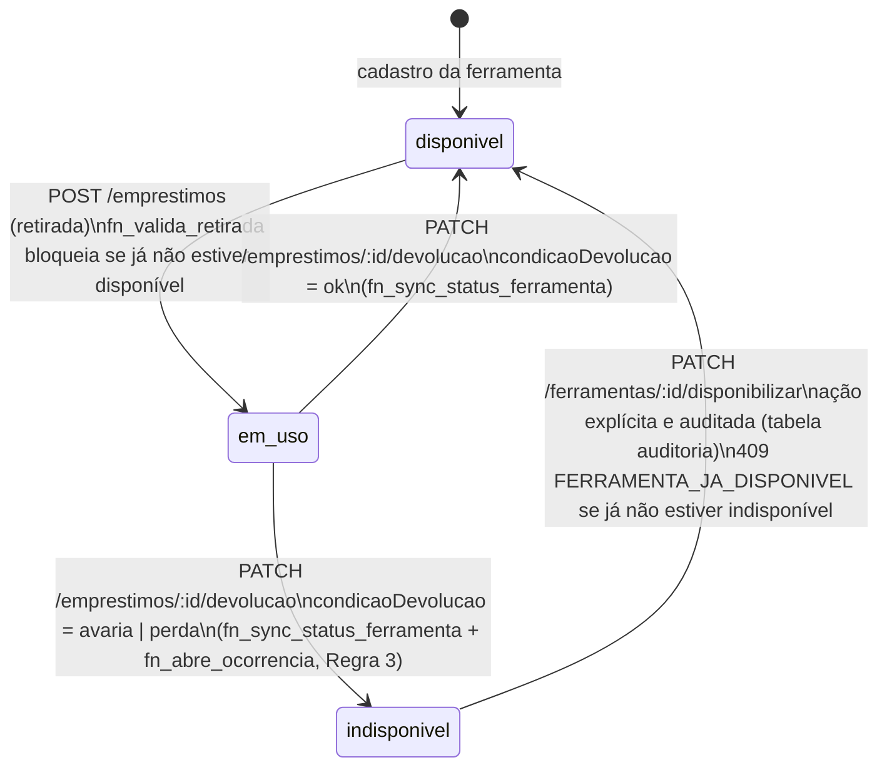

# Regras de negócio do SOUFER Tools

Este documento existe para a issue DATA-04 (#64): uma referência única,
pedida como evidência pelo prof. Max, explicando cada regra automática do
sistema — as 10 regras da Seção 3 do `CLAUDE.md` raiz. Para cada uma: onde
está implementada, o que acontece se for violada, e um exemplo real extraído
do código (migrations, validators, services) ou da suíte de testes.

As regras 1 a 9 são regras de **sistema** (têm implementação técnica). A
regra 10 é uma regra **institucional do curso**, tratada separadamente ao
final.

**Revisão de 20/10/2026 (DATA-08, entrega de Transformação, Validação e
Qualidade dos Dados).** As referências a código foram conferidas contra o
repositório atual (referências a testes agora citam o **nome do teste**, que não
muda quando o arquivo cresce), os trechos que tinham ficado para trás foram
atualizados (perfis da regra 8, fallback da regra 9, concorrência da regra 7) e
duas peças novas entraram no ciclo de cada regra: a **auditoria** automática em
jsonb e o comando **`npm run data:check`**. O fim do documento traz o
[mapa regra → implementação → teste → verificação](#mapa-regra--implementação--teste--verificação)
e a seção sobre [como as regras são rastreadas e conferidas](#rastreabilidade-e-verificação-das-regras).

---

## Regra 1 — Um empréstimo aberto por ferramenta

**O que diz:** uma ferramenta não pode ter dois empréstimos abertos ao mesmo
tempo. Garantido pelo banco, não só pela API.

**Onde está implementada:**
- Índice único parcial `uq_emprestimo_aberto`
  (`api/db/migrations/0001_init.sql:209-211`):
  ```sql
  CREATE UNIQUE INDEX IF NOT EXISTS uq_emprestimo_aberto
  ON emprestimos (ferramenta_id, COALESCE(item_kit_id, 0))
  WHERE data_devolucao IS NULL;
  ```
- Reforçada pela trigger `fn_valida_retirada`
  (`api/db/migrations/0001_init.sql:348-371`), que bloqueia a retirada se a
  ferramenta (não-kit) não estiver com `status = 'disponivel'`.

**O que acontece se for violada:** a tentativa de `INSERT` que colidiria com
o índice único (ou a trigger) falha no banco com erro de restrição. A camada
de serviço (`api/src/services/emprestimoService.ts:60-67`) captura esse erro
do Postgres e traduz para **HTTP 409** com
`error.code = "FERRAMENTA_INDISPONIVEL"` (envelope de erro padrão da Seção 5
do `CLAUDE.md`).

**Exemplo real:** teste
`api/src/tests/emprestimoRoutes.test.ts` —
`'recusa ferramenta já emprestada com 409 FERRAMENTA_INDISPONIVEL'`: faz uma
retirada, repete o `POST /v1/emprestimos` para a mesma ferramenta e confirma
`res.status === 409` com o código acima. O caso de kit (peça avulsa vs. kit
inteiro) é coberto no teste `'empresta uma peça avulsa e bloqueia repetir a peça
e emprestar o kit inteiro (409)'` (mesmo arquivo).

**Rastro e conferência:** a retirada deixa uma linha `INSERT` em `auditoria`
(tabela `emprestimos`) e o `UPDATE` de status da ferramenta para `em_uso`
(tabela `ferramentas`). `npm run data:check` procura o que esta regra deveria
impedir: `EM_USO_SEM_EMPRESTIMO` e `EMPRESTIMO_ABERTO_FERRAMENTA_NAO_EM_USO`.

---

## Regra 2 — Três estados da ferramenta, indisponível separado de em uso

**O que diz:** o status da ferramenta só pode ser `disponivel`, `em_uso` ou
`indisponivel`; indisponível é uma seção separada de "em uso" nas telas,
nunca aparecem juntas.

**Onde está implementada:**
- Enum `status_ferramenta` com exatamente esses três valores
  (`api/db/migrations/0001_init.sql:36-40`).
- View `vw_dashboard_kpis` já contabiliza os três separadamente
  (`api/db/migrations/0001_init.sql:554-561`).
- No front, páginas distintas (`web/src/pages/FerramentasPage.tsx` e
  `web/src/pages/IndisponiveisPage.tsx`), roteadas separadamente em
  `web/src/router.tsx`.

**O que acontece se for violada:** não é uma regra "violável" em tempo de
execução — é uma restrição de tipo. Qualquer valor fora dos três falha no
`INSERT`/`UPDATE` com erro de tipo do Postgres (`invalid input value for
enum status_ferramenta`), antes de qualquer lógica de negócio rodar.

**Exemplo real:** a coluna `ferramentas.status` nasce com `DEFAULT 'disponivel'`
(o seed não cadastra ferramentas: elas entram pela aplicação ou pela importação
de CSV); os outros dois estados só aparecem através do fluxo real de retirada
(`em_uso`) e devolução com avaria/perda (`indisponivel`) — ver Regra 3. O teste
`api/src/tests/emprestimoRoutes.test.ts` confere a ferramenta em `em_uso` logo
depois da retirada (`'registra a retirada (201), coloca a ferramenta em uso...'`).

**Conferência:** `data:check` (`INDISPONIVEL_SEM_MOTIVO`,
`MOTIVO_COM_STATUS_DIFERENTE`) garante que "indisponível" sempre tem o motivo
gravado e que o motivo não sobra em ferramenta que voltou a circular.

---

## Regra 3 — Avaria/perda na devolução abre ocorrência automaticamente

**O que diz:** se a devolução é registrada com avaria ou perda, uma
ocorrência é aberta automaticamente, herdando o colaborador responsável, e a
ferramenta vai para `indisponivel` com o motivo gravado.

**Onde está implementada:**
- Trigger `fn_abre_ocorrencia` (`api/db/migrations/0001_init.sql:472-508`),
  disparada depois do `UPDATE` em `emprestimos` que registra a devolução:
  insere em `ocorrencias` herdando `colaborador_id` do empréstimo quando
  `condicao_devolucao IN ('avaria', 'perda')`.
- Trigger irmã `fn_sync_status_ferramenta`
  (`api/db/migrations/0001_init.sql:436-469`), que muda
  `ferramentas.status` para `'indisponivel'` e grava `motivo_indisponivel`.

**O que acontece se for violada:** não é uma validação que recusa uma
requisição — é um efeito automático de trigger de banco, disparado em
qualquer `UPDATE` que leve a essa condição, inclusive fora da API. Não há
como contornar via corpo da requisição.

**Exemplo real:** `api/src/tests/emprestimoRoutes.test.ts`, testes
`'devolução com avaria (200) deixa a ferramenta indisponivel e abre ocorrência
com o colaborador certo'` e `'devolução com perda (200)...'` — devolver com
`condicaoDevolucao: 'avaria'` resulta em `ferramentas.status = 'indisponivel'`,
`motivo_indisponivel = 'avaria'`, e uma linha nova em `ocorrencias` com o
`colaborador_id` correto. A resposta da devolução devolve o `ocorrencia_id`
criado, e a foto da avaria (opcional, migration `0013`) é anexada depois em
`PUT /v1/ocorrencias/:id/foto`.

**Rastro e conferência:** as três mudanças encadeadas pela devolução (empréstimo,
ferramenta e ocorrência) geram três linhas de `auditoria`, todas com o usuário do
token (teste `auditoria.test.ts`, caso "retirada e devolução com avaria geram
linhas nas três tabelas encadeadas pelas triggers"). `data:check` confere
`INDISPONIVEL_SEM_OCORRENCIA_ABERTA`, `OCORRENCIA_ABERTA_FERRAMENTA_DISPONIVEL` e
`OCORRENCIA_SEM_COLABORADOR_COM_EMPRESTIMO` (a ocorrência herda o colaborador).

### Diagrama de estados da ferramenta (bônus "se sobrar tempo")

As Regras 1, 2 e 3 juntas definem a máquina de estados completa de
`ferramentas.status`. Toda transição é automática (trigger de banco) ou uma
ação explícita e auditada (nunca um `UPDATE` livre de status pelo corpo da
requisição — não há rota que aceite `status` diretamente, ver Regra 6 e a
issue API-14):



Observações sobre o diagrama:

- A transição `indisponivel → disponivel` **não é automática** — é a única
  ação explícita das quatro, de propósito (regra de negócio documentada em
  `api/src/services/ferramentaService.ts:243-246`: "após o reparo, a
  disponibilização deve ser uma ação explícita e auditável"). Tentar
  disponibilizar uma ferramenta que já está disponível devolve **409
  FERRAMENTA_JA_DISPONIVEL**.
- Ferramentas marcadas `eh_kit = true` têm uma variação: o status do kit
  inteiro só é sincronizado quando o registro de empréstimo/devolução é do
  kit inteiro (`item_kit_id IS NULL`); devolver uma peça avulsa com
  avaria/perda abre a ocorrência mas não muda o status do kit container (ver
  `docs/decisoes-pendentes.md`, seção "Devolução de peça avulsa de kit").

---

## Regra 4 — Atividade é campo opcional na retirada

**O que diz:** a atividade (para que a ferramenta vai ser usada) é opcional
na retirada.

**Onde está implementada:**
- `atividadeId` e `atividadeObservacao` são `.optional()` em
  `criarEmprestimoSchema` (`api/src/validators/emprestimoValidator.ts:50-51`).
- Coluna `emprestimos.atividade_id` é `NULLABLE`
  (`api/db/migrations/0001_init.sql:186`).

**O que acontece se for violada:** não há violação possível — é um campo
opcional, nunca gera erro por estar ausente.

**Exemplo real:** `api/src/tests/emprestimoRoutes.test.ts` —
`'aceita retirada sem atividade (Regra 4)'`: `POST /v1/emprestimos` sem
`atividadeId` retorna **201** com `atividade_id: null`.

---

## Regra 5 — Identificação do colaborador por matrícula, crachá ou nome

**O que diz:** a identificação aceita matrícula, código de crachá ou nome;
se não encontrar, abre cadastro rápido no meio do fluxo, sem perder o que já
foi preenchido.

**Onde está implementada:**
- `GET /v1/colaboradores/identificar` (rota `/identificar` em `api/src/routes/v1/colaboradorRoutes.ts`)
  → `colaboradorService.identificar`: tenta matrícula exata primeiro, depois
  nome tolerante a acento/erro de digitação via `unaccent` + `pg_trgm`
  (índice `idx_colaboradores_nome_trgm`,
  `api/db/migrations/0003_colaboradores_identificacao.sql:29-30`).
- Cadastro rápido reaproveita o mesmo `POST /v1/colaboradores` já usado pela
  tela de cadastro, aberto a `manutencao`/`admin`.

**Divergência conhecida:** o schema não tem `codigo_cracha` como campo
separado — foi removido já no `0001_init.sql` porque, na prática, o crachá
**é** a própria matrícula (comentário explícito em
`api/src/validators/colaboradorValidator.ts:34-36`). A regra 5 ainda fala em
"código de crachá" como algo distinto da matrícula; o código trata os dois
como o mesmo valor.

**O que acontece se for violada (não encontrado):** retorna **404** — sinal
para o front abrir o cadastro rápido.

**Exemplo real:** `api/src/tests/colaboradorRoutes.test.ts` —
`'retorna 404 quando não encontra nenhum colaborador para o termo'`.

**Conferência:** a matrícula é validada em três camadas (Zod: 4 dígitos de
`0001` a `9999`; `UNIQUE`; `CHECK chk_colaboradores_matricula_formato` no banco).
`data:check` ainda confere `COLABORADOR_MATRICULA_DUPLICADA` ignorando maiúsculas
e espaços, para dado que tenha entrado por fora da API.

---

## Regra 6 — Responsável pelo registro vem sempre do JWT

**O que diz:** `usuario_retirada_id`, `usuario_devolucao_id`,
`registrada_por`, `criado_por` (e campos equivalentes como `resolvida_por`)
nunca são aceitos vindos do corpo da requisição — sempre do usuário logado.

**Onde está implementada:** comentários explícitos e código consistente em
todos os validators de escrita (ver o comentário "Regra 6" em
`api/src/validators/emprestimoValidator.ts` — nos schemas de retirada e de
devolução —, em `colaboradorValidator.ts` e em `ocorrenciaValidator.ts`). Os
controllers passam o ID do usuário autenticado (`req.usuario!.id`)
separadamente do `req.body` para o service. Desde a migration `0014` o mesmo id
também é entregue ao banco no começo de cada transação de escrita
(`definirUsuarioAuditoria`, `set_config('app.usuario_id', …)`), e é ele que a
trigger de auditoria grava em `auditoria.usuario_id`.

**O que acontece se for violada:** campos desconhecidos enviados no corpo
são **descartados silenciosamente pelo Zod** (comportamento padrão do
`z.object()`, sem `.passthrough()`/`.strict()` em nenhum schema de escrita)
— não há erro, o valor do JWT prevalece. Decisão registrada em
`docs/decisoes-pendentes.md` sobre não usar `.strip()` explícito por ser
redundante com esse comportamento.

**Exemplo real:** `api/src/tests/emprestimoRoutes.test.ts` —
`'ignora usuarioRetiradaId enviado no corpo (Regra 6)'`: envia
`{ usuarioRetiradaId: 999999, usuario_retirada_id: 999999 }`, recebe 201, e o
banco grava o ID do token, não `999999`. Cobertura equivalente em pelo menos
mais 6 rotas (colaboradores, devolução, ocorrências, convite de acesso) — ver
issue API-14. A prova de ponta a ponta com a auditoria está em
`api/src/tests/auditoria.test.ts`: a devolução enviada com
`usuarioDevolucaoId: 999999` no corpo grava, em `emprestimos` e em `auditoria`,
o id do token.

---

## Regra 7 — Código de patrimônio (⚠️ divergência entre o texto e o código real)

**O que o texto da regra diz:** código de patrimônio gerado a partir do ID
(`SF` + 6 dígitos), mesmo valor codificado no código de barras (Code128).
Marcada como **"em revisão"** no `CLAUDE.md` desde a visita técnica à Soufer
(issue DB-01).

**O que o código realmente faz hoje:** gera um `codigo_identificacao`
**SMALLINT de 4 dígitos (1 a 9999)**, sem prefixo `SF` e sem relação com o
`id` da linha:
- Coluna com `CHECK` (`api/db/migrations/0001_init.sql:144`):
  `codigo_identificacao SMALLINT CHECK (codigo_identificacao BETWEEN 1 AND 9999)`.
- Trigger `fn_gera_codigo_identificacao`
  (`api/db/migrations/0001_init.sql:273-300`): busca o menor código livre
  entre 1 e 9999, serializado com `pg_advisory_xact_lock` para evitar corrida
  entre cadastros concorrentes (ver `docs/issues/api-13-endpoints-ocorrencias.md`
  para o histórico dessa correção).
- Unicidade só entre ferramentas ativas, via índice parcial
  `uq_ferramenta_codigo_ativo` (`api/db/migrations/0001_init.sql:163-165`) —
  o código é reaproveitável quando a ferramenta é baixada (`ativo = false`).
- Não existe, em nenhum lugar do código (`api/src/`), geração ou validação de
  um formato `SF######` — a busca por `"SF"`/`codigo_patrimonio` não retorna
  nada.

**Por que a divergência não foi corrigida nesta issue:** o próprio
`CLAUDE.md` já marca a Regra 7 como pendente de decisão em ata (scanner vs.
gravação a lápis elétrico, etiqueta 50x25mm que não sobrevive à manutenção).
Documentar aqui o comportamento real, com esta nota explícita, em vez de
reescrever a regra por conta própria.

**O que acontece se for violada:** inserir um valor fora de 1-9999 falha no
`CHECK` do banco. Esgotar os 9999 códigos ativos dispara
`RAISE EXCEPTION 'Limite máximo de 9999 ferramentas ativas atingido...'`
(`api/db/migrations/0001_init.sql:287`).

**Exemplo real:** `api/src/tests/ferramentaService.test.ts` cadastra uma
ferramenta sem informar `codigo_identificacao` (bloco que cria a ferramenta com
histórico) e confirma que a trigger gera o valor automaticamente. A geração
concorrente (dois cadastros simultâneos disputando o mesmo código) foi corrigida
na migration `0005_corrige_concorrencia_codigo_identificacao.sql` (serializa com
`pg_advisory_xact_lock`) e hoje tem teste permanente em
`api/src/tests/ferramentaCodigo.test.ts`: `'12 inserções em paralelo, cada uma na
sua conexão, recebem códigos distintos e nenhuma falha'` e `'300 ferramentas numa
transação ganham códigos distintos'`.

**Conferência:** `data:check` (`FERRAMENTA_CODIGO_DUPLICADO`) confirma que não há
dois códigos iguais entre as ferramentas ativas. Para o caso "esgotou os 9999
códigos", a mensagem da trigger sai como `409 BUSINESS_RULE_VIOLATION`.

---

## Regra 8 — Três perfis e suas permissões

**Atualização de 01/10/2026:** `admin` é a manutenção com recursos a mais — tudo
que a manutenção faz (balcão, etiqueta, atividades, retirada/devolução) o admin
também faz; a manutenção nunca tem permissão que o admin não tenha. Os
parágrafos abaixo (30/09/2026) que dizem que o admin recebe 403 no balcão ou ao
editar atividades estão superados; os testes já refletem a nova regra.

**O que diz (atualizado em 30/09/2026):** `manutencao` opera o balcão
(retirada, devolução, consulta, indisponíveis, calendário, histórico, e faz
cadastro rápido de colaborador); `admin` cria os colaboradores, gera o link de acesso de cada um e cuida dos
cadastros auxiliares (Colaboradores, Ferramentas, Categorias, Setores —
edição/inativação exclusivas do admin, leitura/criação de
ferramenta/colaborador abertas à manutenção) e, desde esta issue, também lê
e cadastra Atividades; `consulta` tem sessão de 15 minutos só leitura (nome, categoria, status e localização da ferramenta; nunca quem está com ela, histórico ou valores), com token isolado do da manutenção/admin.

**Onde está implementada** (confirmado rota a rota em 20/10/2026, `authorize(...)` em cada
arquivo de `api/src/routes/v1/`). O `admin` entra em todas as rotas da manutenção; a coluna
"Só admin" lista o que a manutenção **não** pode fazer:

| Recurso | Manutenção e admin | Só admin |
|---|---|---|
| Ferramentas | listar, detalhe, por código, histórico, cadastrar, marcar etiqueta impressa, disponibilizar | editar (`PATCH /:id`), baixar (`DELETE`), foto (`PUT` e `DELETE /:id/foto`) |
| Colaboradores | listar, detalhe, identificar, cadastrar (cadastro rápido) | editar, inativar, gerar link de acesso (`POST /:id/convite`) |
| Setores e categorias | listar, detalhe | cadastrar, editar, inativar |
| Atividades | tudo (listar, cadastrar, editar, inativar) | — |
| Empréstimos, ocorrências, notificações, dashboard, exportação | tudo | — |
| Feriados | sincronização forçada (`POST /v1/feriados/sincronizar`) | — (a leitura é pública) |
| KPIs | todos, menos o ranking de colaboradores | `GET /v1/kpis/colaboradores-que-mais-retiram` |
| Importação de CSV | ferramentas e colaboradores | categorias e setores |
| Auditoria (`GET /v1/auditoria`) | — | consulta da trilha |
| `consulta` (sessão de 15 minutos) | só `GET /v1/consulta/ferramentas`, com token isolado | — |

O 403 genérico vem de `api/src/middlewares/authorize.ts` (função `authorize`,
`error.code = "ACCESS_DENIED"`). O auto-cadastro com aprovação (`/v1/usuarios`) deixou de
existir em 01/10/2026: o colaborador cadastrado pelo admin já é o funcionário e recebe o
link de acesso.

**Histórico (30/09/2026):** o texto da regra já dizia que o admin "lê e cadastra"
atividades, mas `atividadeRoutes.ts` autorizava só `manutencao`; foi corrigido e, na decisão
de 01/10/2026 ("o admin é a manutenção com recursos a mais"), `PUT`/`PATCH`/`DELETE` de
atividades também passaram a aceitar o admin.

**O que acontece se for violada:** **HTTP 403** com `error.code =
"ACCESS_DENIED"` e `details: [{ requiredRoles, userRole }]`.

**Exemplo real:**
- `api/src/tests/permissoesCadastros.test.ts` — manutenção lê mas recebe 403
  em escrita de setores/categorias e admin passa nas rotas do balcão.
- `api/src/tests/ferramentaPermissoes.test.ts` — par simétrico em ferramentas.
- `api/src/tests/authorize.test.ts` e `consultaSessao.test.ts` — o token da
  consulta e o da manutenção/admin são isolados nos dois sentidos.
- `api/src/tests/auditoriaRoutes.test.ts` — `GET /v1/auditoria` devolve 401 sem
  token e 403 para manutenção e consulta.

---

## Regra 9 — Feriados da BrasilAPI com cache e fallback

**O que diz:** feriados vêm da BrasilAPI, com cache em tabela própria e
fallback de sábado/domingo se a API estiver fora.

**Onde está implementada** (`api/src/services/feriadoService.ts`):
- `buscarNaBrasilApi`: chama
  `https://brasilapi.com.br/api/feriados/v1/{ano}`; falha de rede ou status
  não-OK lança `AppError(502, 'BRASIL_API_UNAVAILABLE')`.
- Cache: tabela `feriados` (`api/db/migrations/0001_init.sql:246-253`),
  preenchida por `sincronizarFeriados` (upsert).
- `gerarFallbackFinsDeSemana`: gera só sábados/domingos do
  ano, marcados com `tipo: 'fallback_fim_de_semana'`.
- `listarPorAno`: prioriza o cache; se vazio, tenta
  sincronizar; se a BrasilAPI falhar (`BRASIL_API_UNAVAILABLE`), cai no
  fallback e retorna `fonte: 'fallback_fim_de_semana'` em vez de propagar o
  erro ao cliente.

**O que acontece se for violada (fonte externa indisponível):** não é
tratado como erro para quem chama a API — é um fallback silencioso
(`console.warn` no serviço); o cliente recebe 200 com
`fonte: 'fallback_fim_de_semana'` em vez de um 502. Só a falha **da BrasilAPI**
vira fallback: se o erro for do banco (por exemplo, o upsert falhar), ele é
repassado e a API responde erro de verdade, sem mascarar problema de
infraestrutura como "feriado indisponível".

**Exemplo real:** `api/src/tests/feriado.test.ts` cobre o caminho de cache e o
cálculo de dias úteis com feriados (Tiradentes, Carnaval, virada de ano), e
`api/src/tests/feriadoFallback.test.ts` (novo) simula a rede com um `fetch` falso e cobre
o fallback: BrasilAPI com erro de rede, BrasilAPI respondendo 503, fallback com os 104
sábados e domingos de um ano, gravação em cache com upsert (a segunda leitura vem do
cache, sem nova chamada) e a falha de banco **não** mascarada como fallback. A lacuna
que este documento apontava na versão anterior (fallback sem teste automatizado) está
fechada.

**Conferência:** `npm run db:feriados -- <ano>` grava os feriados reais e o
`GET /v1/feriados/dia-util` os usa (evidência em
`docs/entregas-pi/integracao-de-dados-max-vallim/27-10-2026/evidencias/08-feriados-brasilapi.md`).

---

## Regra 10 — Entrega fora do prazo ou impressa = nota zero

**Sem implementação técnica — é uma regra institucional do curso, não do
software.** É um critério de avaliação do Projeto Integrador sobre o
processo de entrega do trabalho acadêmico (prazo no Classroom, formato
digital), não uma regra de negócio do sistema SOUFER Tools. Não há, e não
deveria haver, trigger, validação ou endpoint associado a ela — nenhuma
busca no código por "nota zero", "prazo de entrega" ou afins retorna
qualquer rotina relacionada (a única menção a "impressão" no código é
`etiqueta_impressa_em` em `ferramentas`, a etiqueta de código de barras da
ferramenta, sem relação com a entrega do trabalho).

---

## Resumo

| # | Regra | Implementação técnica | Status |
|---|---|---|---|
| 1 | Empréstimo único por ferramenta | Índice único + trigger | ✅ Implementada, testada, auditada e conferida pelo `data:check` |
| 2 | 3 estados da ferramenta | Enum + páginas separadas | ✅ Implementada; coerência de motivo conferida pelo `data:check` |
| 3 | Avaria/perda abre ocorrência | 2 triggers encadeadas | ✅ Implementada, testada e auditada (3 tabelas encadeadas) |
| 4 | Atividade opcional | Schema Zod | ✅ Implementada e testada |
| 5 | Identificação por matrícula/nome | Service + índice trgm + CHECK | ✅ Implementada e testada (divergência do "crachá" documentada) |
| 6 | Autoria sempre do JWT | Validators + controllers + `app.usuario_id` | ✅ Implementada e testada em 7+ rotas; provada na auditoria |
| 7 | Código de patrimônio | Trigger + CHECK + advisory lock | ⚠️ Implementada e testada com concorrência, mas diverge do texto formal (4 dígitos, não `SF`+6) |
| 8 | 3 perfis e permissões | `authorize()` por rota | ✅ Implementada; matriz revisada em 20/10/2026 |
| 9 | Feriados BrasilAPI + fallback | Service com cache | ✅ Implementada e testada, inclusive o fallback e a falha de banco |
| 10 | Entrega fora do prazo = zero | — | N/A — regra institucional, sem implementação de software |

---

## Rastreabilidade e verificação das regras

Regra escrita só no código não prova que o **dado** está certo. Por isso cada regra tem, além
da implementação e do teste, duas peças que olham para o dado já gravado:

**1. Auditoria automática (migration `0014`).** Toda alteração real em `ferramentas`,
`emprestimos` e `ocorrencias` gera uma linha em `auditoria` (jsonb), por trigger do banco:
`INSERT` guarda o registro inteiro, `UPDATE` guarda **só as colunas que mudaram** (antes e
depois) e `DELETE` guarda o registro apagado. O `usuario_id` vem do JWT (regra 6). A consulta
é `GET /v1/auditoria` (só admin). Exemplo real, uma devolução com avaria:

```json
{ "tabela": "ferramentas", "operacao": "UPDATE",
  "dados_anteriores": { "status": "em_uso", "motivo_indisponivel": null },
  "dados_novos": { "status": "indisponivel", "motivo_indisponivel": "avaria" } }
```

**Uma ação de negócio pode deixar mais de uma linha.** As linhas gravadas à mão
(`disponibilizar`, login, convite) convivem com as das triggers, e as duas aparecem em
`GET /v1/auditoria`. `PATCH /v1/ferramentas/:id/disponibilizar`, por exemplo, deixa: (1) uma
linha `disponibilizar` em `ferramentas`, que guarda o antes e o depois do status e do motivo e
representa a decisão explícita da pessoa; (2) uma linha `UPDATE` automática em `ferramentas`
(status e `motivo_indisponivel`); e (3) uma `UPDATE` automática em `ocorrencias` para cada
ocorrência que a ação resolve. Para contar **ações**, filtre por `operacao=disponibilizar`; para
reconstruir o **estado** de um registro, use as linhas `INSERT`, `UPDATE` e `DELETE`. O IP de
origem (`ip_origem`) vem de `req.ip` e é gravado só nas linhas das triggers; as manuais ainda
não o preenchem.

**2. Verificação de consistência (`npm run data:check`).** 19 consultas somente de leitura
procuram o que as regras deveriam ter impedido. Aceita `--json` (para CI) e `--so-erros`,
sai com `0` quando não há erro, `1` quando há e `2` se não conseguiu rodar. Cada verificação
é testada forçando a inconsistência dentro de uma transação revertida
(`api/src/tests/dataCheck.test.ts`). Duas verificações (`FERRAMENTA_CODIGO_DUPLICADO` e
`COLABORADOR_MATRICULA_DUPLICADA`) são defensivas: o banco já impede o caso, e o teste prova
que o banco o recusa (erro `23505`) e que a verificação roda limpa.

## Mapa regra → implementação → teste → verificação

| # | Camada | Implementação | Teste que prova | `data:check` |
|---|---|---|---|---|
| 1 | Banco + API | `uq_emprestimo_aberto`, `fn_valida_retirada`, `emprestimoService` (409) | `emprestimoRoutes.test.ts`: recusa ferramenta já emprestada; peça avulsa × kit | `EM_USO_SEM_EMPRESTIMO`, `EMPRESTIMO_ABERTO_FERRAMENTA_NAO_EM_USO` |
| 2 | Banco + front | enum `status_ferramenta`, páginas de Ferramentas e Indisponíveis | `emprestimoRoutes.test.ts`: retirada põe em uso; `ferramentaService.test.ts`: disponibilizar tira a ferramenta de indisponível e audita | `INDISPONIVEL_SEM_MOTIVO`, `MOTIVO_COM_STATUS_DIFERENTE` |
| 3 | Banco | `fn_abre_ocorrencia`, `fn_sync_status_ferramenta` | `emprestimoRoutes.test.ts`: devolução com avaria e com perda; `auditoria.test.ts`: três trilhas encadeadas | `INDISPONIVEL_SEM_OCORRENCIA_ABERTA`, `OCORRENCIA_ABERTA_FERRAMENTA_DISPONIVEL`, `OCORRENCIA_SEM_COLABORADOR_COM_EMPRESTIMO` |
| 4 | API + banco | `atividadeId` opcional (Zod), coluna sem `NOT NULL` | `emprestimoRoutes.test.ts`: aceita retirada sem atividade | — (campo opcional, nada a conferir) |
| 5 | API + banco | `colaboradorService.identificar`, `idx_colaboradores_nome_trgm`, CHECK de matrícula | `colaboradorRoutes.test.ts`: identificar (404 e achados) | `COLABORADOR_MATRICULA_DUPLICADA` |
| 6 | API | validators sem o campo, `req.usuario!.id`, `definirUsuarioAuditoria` | `emprestimoRoutes.test.ts`, `ocorrenciaRoutes.test.ts`, `colaboradorRoutes.test.ts`, `auditoria.test.ts` | `AUDITORIA_TRIGGER_AUSENTE`, `AUDITORIA_SEM_REGISTRO` |
| 7 | Banco | `fn_gera_codigo_identificacao`, `uq_ferramenta_codigo_ativo`, CHECK 1 a 9999 | `ferramentaCodigo.test.ts` (paralelo e lote), `ferramentaService.test.ts` | `FERRAMENTA_CODIGO_DUPLICADO` |
| 8 | API | `authorize()`, token de consulta isolado | `permissoesCadastros.test.ts`, `ferramentaPermissoes.test.ts`, `authorize.test.ts`, `consultaSessao*.test.ts`, `auditoriaRoutes.test.ts` | — (permissão não deixa marca no dado) |
| 9 | API + banco | `feriadoService`, tabela `feriados` | `feriado.test.ts`, `feriadoFallback.test.ts` | — |
| 10 | — (institucional) | — | — | — |
| — | Validação geral | Zod em todas as rotas de escrita, `errorHandler` | `ferramentaValidation.test.ts`, `errorHandler.test.ts`, `kpi.test.ts`, `importacaoFerramentas.test.ts` | `FERRAMENTA_VALOR_NEGATIVO`, `FERRAMENTA_NOME_VAZIO`, `FERRAMENTA_SUBGRUPO_FORA_DO_GRUPO`, `EMPRESTIMO_PREVISAO_ANTES_RETIRADA`, `EMPRESTIMO_DEVOLUCAO_ANTES_RETIRADA`, `EMPRESTIMO_DEVOLVIDO_SEM_CONDICAO`, `EMPRESTIMO_COLABORADOR_INATIVO_ABERTO`, `FOTO_ARQUIVO_INEXISTENTE` |

As evidências de execução de cada coluna (saída dos testes, do `data:check`, da importação
e da auditoria) estão em
[`docs/entregas-pi/integracao-de-dados-max-vallim/27-10-2026/evidencias/`](entregas-pi/integracao-de-dados-max-vallim/27-10-2026/evidencias/).
